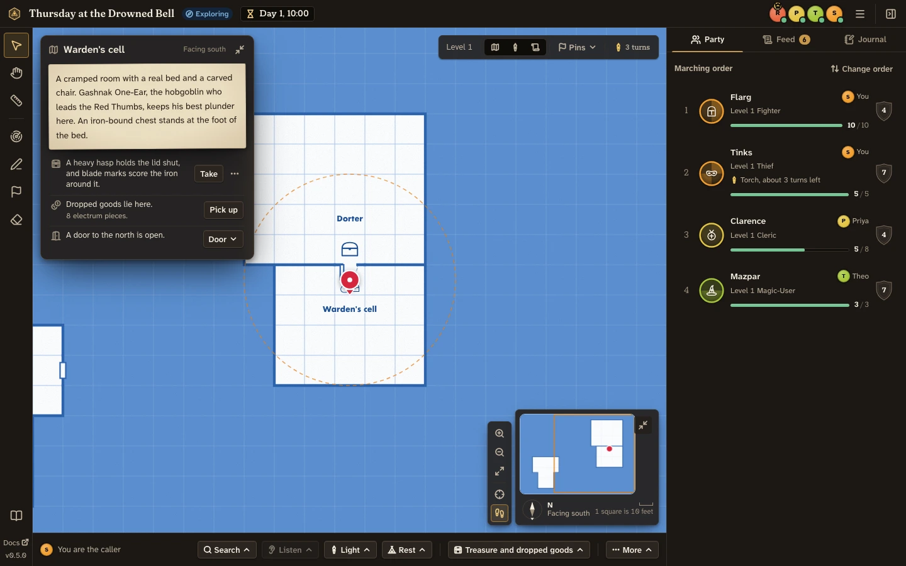

# bxvtt

bxvtt is a virtual tabletop for the 1981 B/X (Basic and Expert) fantasy rules. A referee and a table of players each open the game in their own browser, share one dungeon map, one chat feed, and one party, and play an adventure together. The [bxapi](https://github.com/mmacy/bxapi) rules engine rolls every die, applies every rule, and stores every game, so the table spends its time playing instead of looking up rules.



## Prerequisites

- [Node.js](https://nodejs.org/) 24 or later, which includes npm.
- [git](https://git-scm.com/) to clone the repositories.
- [uv](https://docs.astral.sh/uv/) to run bxapi. If Python 3.14 isn't installed, uv downloads it the first time you start bxapi.
- A checkout of bxapi. Clone it next to bxvtt:

  ```sh
  git clone https://github.com/mmacy/bxapi.git
  ```

- A current desktop browser for every person at the table, with a window at least 820 pixels wide. The end-to-end suite runs in Chromium.

## Get it running

1. Clone bxvtt and install its packages:

   ```sh
   git clone https://github.com/mmacy/bxvtt.git
   cd bxvtt
   npm install
   ```

   The install also downloads the `cloudflared` program that `npm run share` uses.

2. In a second terminal, start bxapi from its checkout in anonymous mode, which suits one machine that nobody else can reach:

   ```sh
   cd bxapi
   BXAPI_ALLOW_ANONYMOUS=true uv run bxapi
   ```

   The first start takes longer while uv installs Python and the dependencies. When bxapi is ready, it prints this line and keeps running:

   ```text
   INFO:     Uvicorn running on http://127.0.0.1:8640 (Press CTRL+C to quit)
   ```

3. In the first terminal, build bxvtt and start it:

   ```sh
   npm run build
   npm start
   ```

   The server prints one line per event. These two lines mean that it reached bxapi:

   ```text
   {"level":30,...,"msg":"Server listening at http://127.0.0.1:8660"}
   {"level":30,...,"bxapi":"http://127.0.0.1:8640","engine":"2.5.0","msg":"bxapi is reachable"}
   ```

   If the second line is `bxapi is unreachable` instead, start bxapi first. To use a bxapi at another address, set `BXAPI_URL` before you run `npm start`.

4. Open <http://127.0.0.1:8660> in your browser. Type the name that the table will see and select **Continue**.
5. Type a table name, such as `Thursday at the Drowned Bell`, and select **Create table**. You are now the table's referee, and the lobby opens.
6. In the lobby, find the **Invite players** panel and select **Copy**. Send the link to your players. A player opens it, types a name, and selects **Join the table**.

Your players can reach `127.0.0.1` only if they use the same computer. To let people on other networks join, read the next section.

## Play over the internet

`npm run share` publishes your bxvtt server at a public address through a [Cloudflare quick tunnel](https://developers.cloudflare.com/cloudflare-one/connections/connect-networks/do-more-with-tunnels/trycloudflare/). It needs no account and no open port on your router. bxapi stays on your machine and is never published.

1. Make sure that bxapi is running and that you ran `npm run build`. Stop `npm start` if it is running, because `npm run share` starts the server itself.
2. Run the command:

   ```sh
   npm run share
   ```

   After a few seconds, it prints the public address and a host key:

   ```text
   Starting a tunnel with the cloudflared that npm installed with bxvtt...
   {"level":30,...,"msg":"Server listening at http://127.0.0.1:8660"}
   {"level":30,...,"bxapi":"http://127.0.0.1:8640","engine":"2.5.0","msg":"bxapi is reachable"}

     bxvtt is shared at https://example-words-here.trycloudflare.com
     Host key (needed to create a table): 3f9Xk2LmQ0aVb7TnR4sYw8Hd
     Run your own table at http://127.0.0.1:8660, so your sign-in survives the next session.
     Players open the shared address and paste your invite link into "Join a table". They need no key.
     Press Ctrl+C to stop sharing.
   ```

3. Open `http://127.0.0.1:8660` in your browser. Type a table name and select **Create table**. The page then asks for a **Host key**. Enter the key from the terminal and select **Create table** again.
4. In the lobby, select **Copy** in the **Invite players** panel. Send your players the public address and that link. A player opens the public address, types a name, selects **Continue**, pastes the link into **Join a table**, and selects **Join**.

Press Ctrl+C in the terminal to stop sharing. The address changes every time you run the command, so read [Host a table](docs/guide/host.md) before your second session.

## What you can do with it

- **Create characters** for all seven classes with a step-by-step wizard that rolls abilities, checks class requirements, and shops for starting gear. See [Play](docs/guide/play.md#make-a-character).
- **Run the table as referee** with a panel that shows the adventure key, the log behind the screen, and a command for every referee action that bxapi offers. See [Referee](docs/guide/referee.md).
- **Explore a dungeon on a shared map** that shows only what the party has seen, with doors, searching, light, treasure, and the map tools: ping, draw, pin, and ruler. See [Explore](docs/guide/play.md#explore-the-dungeon).
- **Fight as a party.** Each player declares for their own characters, the round resolves, and the table watches the result play back event by event. See [Encounters and battle](docs/guide/play.md#encounters-and-battle).
- **Chat, whisper, and roll dice** in one feed that also logs every game event. See [The feed](docs/guide/play.md#the-feed).
- **Look up any rule** in a compendium of classes, spells, monsters, equipment, magic items, and tables. See [The rules compendium](docs/guide/play.md#the-rules-compendium).
- **Play a sample adventure** or add your own. See [Adventures](docs/guide/adventures.md).
- **Save and restore** the game at any time. See [Saves](docs/guide/referee.md#saves-and-restoring).

## Configuration

The server reads these environment variables. Set them in the terminal before `npm start`, as in `BXVTT_PORT=9000 npm start`.

| Variable | Default | Meaning |
| --- | --- | --- |
| `BXVTT_PORT` | `8660` | Port the bxvtt server listens on. |
| `BXVTT_HOST` | `127.0.0.1` | Address the server listens on. Keep the default and publish with `npm run share`. |
| `BXVTT_DATA_DIR` | `.data` | Folder for the bxvtt database, `bxvtt.db`. |
| `BXAPI_URL` | `http://127.0.0.1:8640` | Where bxapi listens. |
| `BXAPI_KEY` | none | A bxapi key with the `referee` role. Leave it unset when bxapi runs in anonymous mode. |
| `BXVTT_HOST_KEY` | none | When set, a person needs this key to create a table. `npm run share` sets it for you. |
| `BXVTT_PUBLIC_ORIGINS` | none | Extra addresses, separated by commas, that may open the live connection, such as a tunnel's public address. `npm run share` sets it for you. |

The [server README](apps/server/README.md#settings) lists the rest.

## Development

Run bxapi and the development servers in two terminals. The development bxapi comes from `~/repos/bxapi`, or from the folder in `BXAPI_DIR`, and listens on port 8651:

```sh
npm run dev:bxapi    # terminal 1: bxapi on http://127.0.0.1:8651
npm run dev          # terminal 2: bxvtt server on :8660, web client on http://localhost:5180
```

Open <http://localhost:5180>. The client reloads when you change a file.

| Command | What it does |
| --- | --- |
| `npm run check` | The gate. Runs the type checker, ESLint, Prettier, and the unit tests. Run it before you open a pull request. |
| `npm test` | Runs the unit and integration tests. The server tests need a running bxapi on port 8651, or at the address in `BXAPI_URL`. |
| `npm run test:e2e` | Runs the end-to-end suite, which drives a referee and players through a game in Chromium. It needs a running bxapi on port 8651 (or at `BXAPI_URL`) and a one-time `npx playwright install chromium`. |
| `npm run build` | Builds the client and the server. |
| `npm run gen:bxapi` | Regenerates the bxapi types in `packages/shared`. |
| `node docs/images/capture.mjs` | Regenerates the screenshots in `docs/images`. It needs a running bxapi and a build. |

The repository has these parts:

| Path | Contents |
| --- | --- |
| `apps/server` | The bxvtt server: Fastify, SQLite, and a WebSocket. |
| `apps/web` | The browser client: React, Vite, and a canvas map renderer. |
| `packages/shared` | Code that the server and the browser both import: the bxapi types, the bxvtt protocol, and the text for game events. |
| `adventures` | The sample adventures and the tools that build and check them. |
| `e2e` | The Playwright end-to-end tests. |
| `docs` | The guides, the architecture, the security model, and the credits. |
| `scripts` | Development scripts. |

Read [AGENTS.md](AGENTS.md) for the rules that every change follows, and [docs/architecture.md](docs/architecture.md) for the processes, the data each one stores, and the protocol between them.

## License

The bxvtt code is licensed under the [MIT license](LICENSE).

The rules content that bxapi serves comes from osrlib and is Open Game Content under the Open Game License 1.0a. In the rules compendium, select **Open Game License** to read the license text and the Section 15 copyright notice. Fonts, icons, and libraries that bxvtt bundles keep their own licenses, which [docs/credits.md](docs/credits.md) lists.

bxvtt is an independent project and is not affiliated with or endorsed by Necrotic Gnome. "Old-School Essentials" is a trademark of Necrotic Gnome, used here only to identify the source document of the rules content. bxvtt makes no claim of compatibility.
