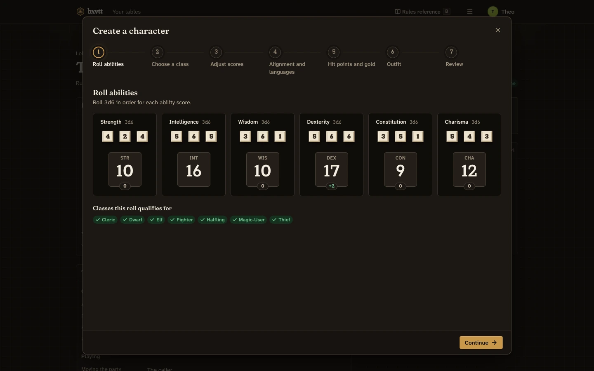
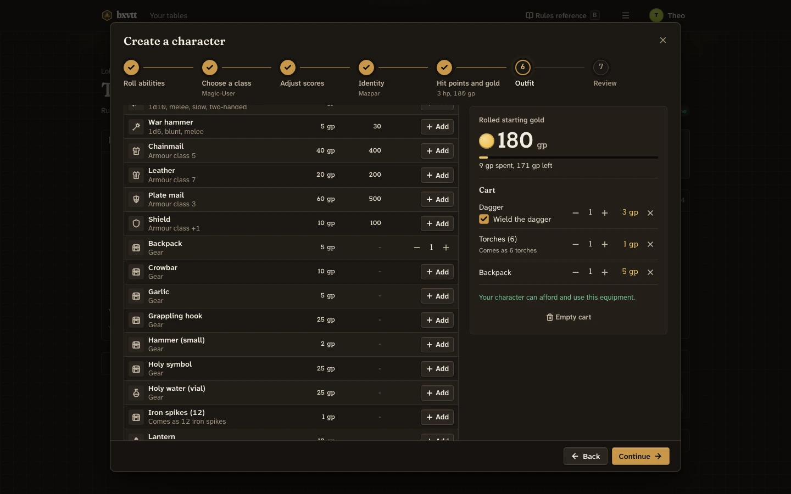
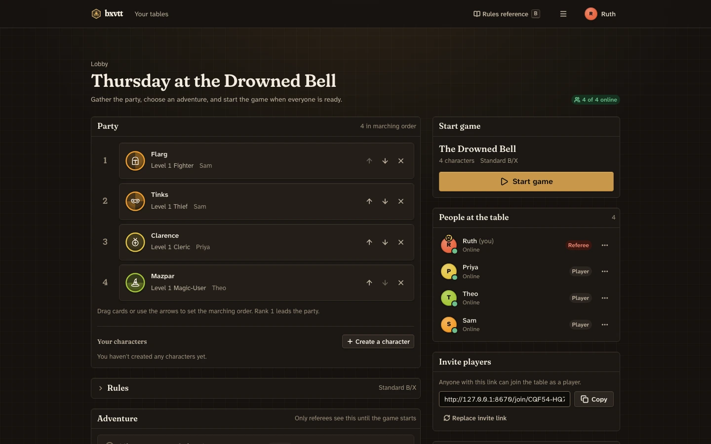
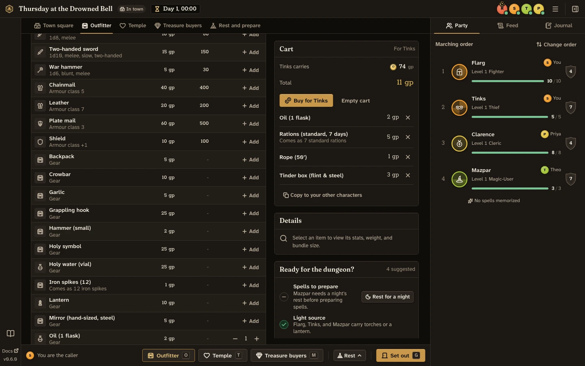
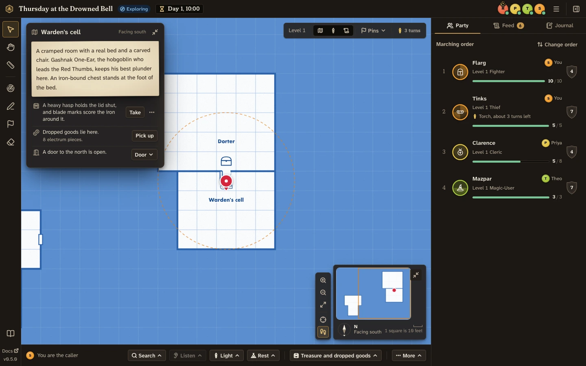
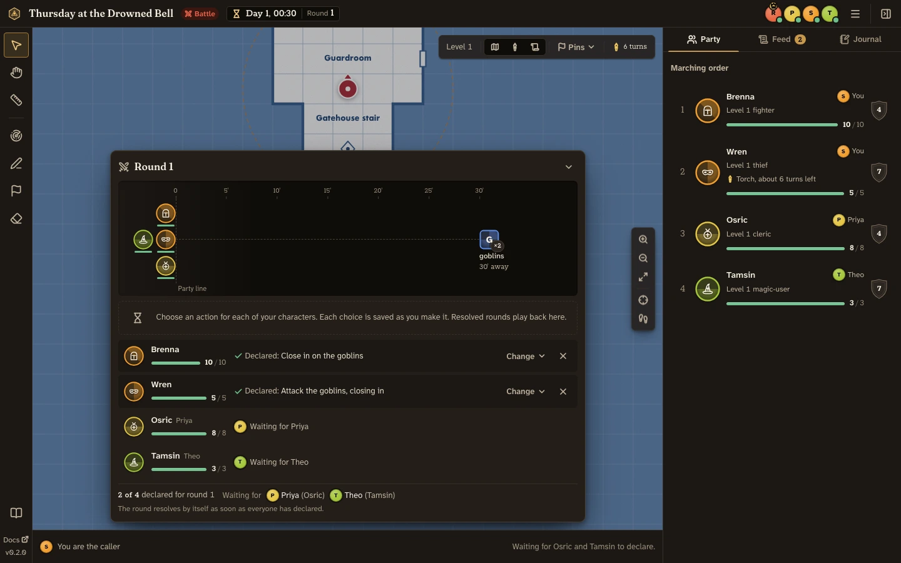
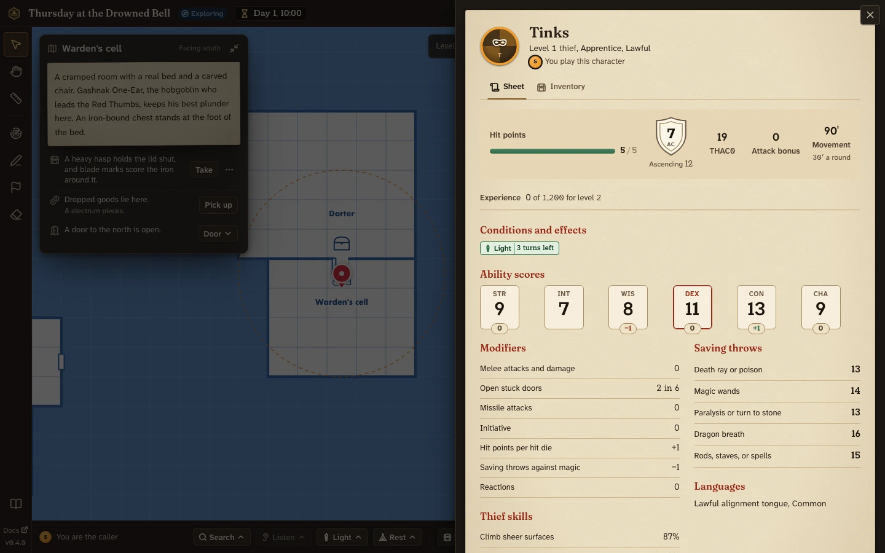
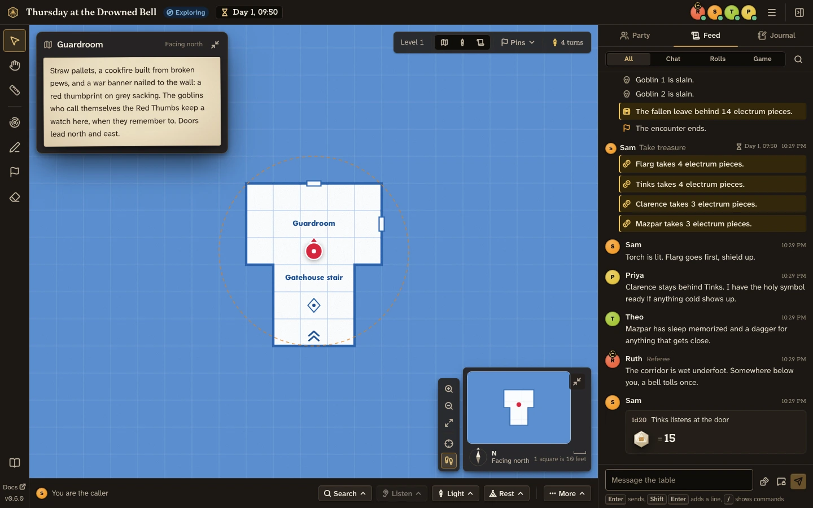
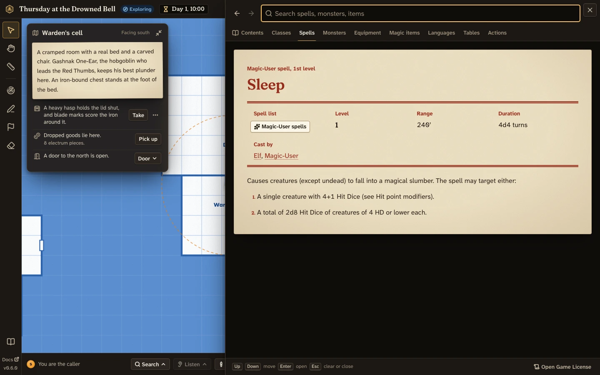

# Play

You play bxvtt in a browser. Your referee sends you a link, you pick a name, you make a character, and the referee starts the game. This guide follows that order. If you are the referee, read the [referee guide](referee.md) too.

## Join a table

1. Open the link that your referee sent you. If the referee sent an address and a separate link, open the address, type your name, select **Continue**, paste the link into **Join a table**, and select **Join**.
2. On the page that says **You're invited to a table**, type the name that the table sees and select **Join the table**. The lobby opens.

You need no account or password. Your browser stores a sign-in for you, and bxvtt knows you by it. Use the same browser and the same address in every session. If you clear your browser's site data or open the link in another browser, you become a new person, and your referee has to give you your characters again.

The play screen needs a window at least 820 pixels wide.

## Make a character

In the lobby, find **Your characters** and select **Create a character**. A window with six steps opens. The numbered bar at the top shows where you are, and **Continue** moves you forward. The wizard keeps your choices in your browser, so you can close the window and come back. **Start over** discards them.

1. **Roll abilities.** Select **Roll ability scores**. The rules engine rolls 3d6 for Strength, Intelligence, Wisdom, Dexterity, Constitution, and Charisma, in that order, and you can't rearrange them. Select **Skip** to end the dice animation. Below the scores, **Classes this roll qualifies for** lists the classes that your scores allow. **Roll again** replaces the scores. The engine lets you roll as often as you like, so ask your referee whether the table allows more than one roll.
2. **Choose a class.** Each card shows the class's requirements, prime requisite, hit die, armour, weapons, and special abilities. The seven classes are cleric, dwarf, elf, fighter, halfling, magic-user, and thief. A class that your scores don't allow shows what it needs. At the bottom, the optional rule **Reroll a first hit die of 1 or 2** applies only if your referee plays with it.
3. **Adjust scores.** You can lower Strength, Intelligence, or Wisdom by 2 points to raise your class's prime requisite by 1, and no score can drop below 9. The step is optional. Select **Skip this step** to keep the scores as rolled.
4. **Identity.** Type a name, or select **Suggest a name**. Choose **Lawful**, **Neutral**, or **Chaotic**. Each alignment brings a secret tongue that you speak. If your Intelligence is 13 or more, you also pick extra languages from the list. A magic-user or an elf picks the spell that starts the spell book.
5. **Outfit.** Spend your starting gold in the shop. Filter the list with **All**, **Weapons**, **Armour**, **Gear**, and **Ammunition**, and select **Add** next to an item to put it in the cart. A button above the list fills the cart with a ready-made kit for your class. The **Cart** shows what you spend and whether your class can use each item. Use the plus and minus buttons to change a quantity, and select **Wield it** or **Wear it** to equip an item when the character is made. You can leave with your gold and shop in town after the game starts.

   

6. **Review.** Check the sheet. The rules engine rolls your hit points when you select **Create character**. A window then says that your character is ready. Select **Make another** to roll the next character, or **Done** to return to the lobby.

A new character joins the party at the end of the marching order. Your referee decides the final order.

## The lobby

The lobby holds the table before the game starts.

- **Party** lists the characters in marching order, which is the order the party walks and fights in. The first rank leads. Select a name to open that character's sheet. Each row has **Move X forward**, **Move X back**, and **Take X out of the party** buttons, where X is the character's name. The referee sets the final order.
- **Your characters** lists characters you made before that aren't in the party yet, each with **Add to party**. It also holds **Create a character**.
- **People at the table** lists everyone, with a green dot for each person who is online.
- **Invite players** holds the link for new players.

Only the referee sees the adventure choice, the optional rules, and **Start the game**. You see **Waiting for the referee to start**. Add your characters while you wait.

## The play screen

When the referee starts the game, the play screen replaces the lobby.

- **The top bar** shows the table's name, the mode badge (**In town**, **Exploring**, **Encounter**, or **Battle**), the game clock (such as `Day 1, 00:30`, plus the round during a battle), who is online, and the table menu. **Hide table panels** hides the dock to give the map more room.
- **The map tools** run down the left edge, with the rules reference at the bottom.
- **The stage** fills the middle. It shows the town, the dungeon map, the monsters, or the battle, depending on the mode.
- **The action bar** runs along the bottom. It shows who the caller is and the actions that fit the moment. When the actions don't fit, the bar shows only icons, and then moves the rest into **More actions**.
- **The dock** on the right has the **Party**, **Feed**, and **Journal** tabs. The referee also has a **Referee** tab. On a narrow window, the dock becomes a drawer.

The table menu holds **Save the game**, **Saves**, **Table settings**, **Seats and caller** (for the referee), **Copy invite link**, **Rules reference**, **Keyboard shortcuts**, **Command palette**, **Your tables**, **Return to the lobby** (for the referee), and **Leave the table**.

### Who does what

In B/X, one player speaks for the party. That player is the caller. The caller moves the party, opens doors, searches, and chooses what the party does when it meets monsters. The action bar says **You are the caller** or names the caller. If the referee changes **Who moves the party** to **Anyone with a character**, every player with a character can do these things.

You always control your own characters: you equip their gear, cast their spells, shop for them, and declare their actions in a battle. A button that you can't use right now is dimmed. Point at it to see why.

### The party panel

The **Party** tab lists your characters in marching order with each one's hit points, armour class, and who plays it. Select a character to open the sheet. **Change order** sets the marching order again.

## Town

Between delves, the party stands in town. The stage has five tabs: **Town square**, **Outfitter**, **Temple**, **Treasure buyers**, and **Rest and prepare**. The action bar has the same places, each with a key: **Outfitter** (O), **Temple** (T), **Treasure buyers** (M), **Rest** (Shift+R), and **Set out** (G).

### Outfit your characters

1. Select **Outfitter**.
2. Under **Shopping for**, select the character who buys. Each button shows that character's gold.
3. Find an item. Search the shelves, or filter with **All**, **Weapons**, **Armour**, **Gear**, and **Ammunition**. Prices are in gold pieces and weights are in coins. Select an item to read its details.
4. Select **Add** next to each item you want. Each member has a separate cart, which shows the total price. **Same for everyone you shop for** copies the cart to the other characters.
5. Select **Buy for** and the character's name. If the character can't pay for the whole cart, bxapi refuses the purchase and nothing is bought.

The **Ready for the dungeon?** panel suggests a light source, a tinder box, rations, and rope. It is a suggestion. Nothing stops the party from leaving without them.

### Visit the temple

1. Select **Temple**.
2. Under **Who needs the temple**, select the character who needs help.
3. Select **Buy** next to a service: cure light wounds, cure serious wounds, cure disease, neutralize poison, remove curse, or raise dead.

The whole party pays, not only the patient. The temple takes the fee from the patient's purse first, then from the others in marching order. Leave **Temple cleric's level** empty and the temple sends the lowest level that can cast the service.

### Sell treasure

Select **Treasure buyers** to sell gems and jewellery that the party carries. Each piece sells for its full value and pays the character who carries it.

### Rest and prepare

Select **Rest and prepare** and choose **Rest one turn** (10 minutes, which a party needs once every six turns in a dungeon), **Rest a night** (8 hours, after which casters can prepare spells), or **Rest a full day**, which also heals everyone who is alive. Preparing spells happens on the character sheet.

### Set out

Select **Set out** and confirm. The party leaves town together and arrives at the dungeon's entrance.

## Explore the dungeon

When the party enters a dungeon, the map becomes the stage. The map shows only what the party has seen.

### Read the map

- A red token marks the party, with a small arrow for the way it faces. The corner panel names the room that the party stands in and describes it. Select **Hide the description** to collapse it.
- Light matters. The party sees only as far as its light reaches. A torch lasts six turns, and the light notice in the lower left shows how many turns remain. Without light, the map says **No light. The party is in the dark.**
- The zoom buttons on the right edge zoom in and out, **Show the whole map** fits what the party has explored, **Center on the party** recenters, and **Follow the party** keeps the party in view as it moves.
- The level selector at the top shows other levels the party has mapped. The small map in the lower right shows where you are, and the compass shows which way the party faces. One square is 10 feet.
- The three buttons at the top change the look of the map: **Blueprint map**, **Torchlit map**, and **Parchment map**. The choice is yours alone.

### Move

Press an arrow key to move the party one square and turn it to face that way. Hold Alt and press an arrow key to turn without moving. You can also click a square beside the party. A wall stops the party, and a closed door stops it until someone opens the door.

Each move takes game time, and the clock in the top bar shows it. The rules engine checks for wandering monsters as time passes.

### Use the action bar

| Action | What it does |
| --- | --- |
| **Search** (S) | Search for secret doors, room traps, or construction tricks. Choose a character to search. |
| **Listen** (L) | Listen at the door in front of the party. It stays dimmed until the party faces a door. |
| **Light** (T) | Light a torch or lantern, or put out a light. |
| **Rest** (Z) | Rest for one turn, a night, or a full day. |
| **Treasure** (G) | Take treasure the party can see. It appears when treasure is in reach. |
| **Return to town** | Leave the dungeon. It appears when the party stands on the entrance. |
| **Other** (M) | Face another way, drop or give items, equip or unequip gear, set the marching order, prepare or learn spells, cast a spell, and use a magic item. |

When the party stands on a staircase or another way between levels, an action such as **Go down the stairs** (U) appears. Select it to change levels.

You can also right-click the map to see a menu of what the party can do where you clicked. A menu is the quickest way to reach a door, a search, or the light.

### Doors

When the party stands beside a door, the corner panel says what kind of door it is, with a **Door** menu:

- **Open it** opens a door that isn't stuck or locked.
- **Force it open** has a character try a stuck door.
- **Pick the lock** lets a thief try a locked door.
- **Listen at it** listens for noise beyond the door.
- **Wedge it shut with a spike** keeps monsters from opening it.

If an attempt fails, the rules engine says so in the feed. The same door can be tried again if the rules allow it.

### Treasure and traps

When the party sees treasure, **Treasure** offers **Take the treasure**, which divides coin and goods among the party, and **Give it all to one member**. A thief can **Check it for traps** and **Disarm the trap**. Goods that fall when monsters die lie where the party stood. Select **Pick up the dropped goods** to take them.

### Map tools

The tools on the left edge work on the map for the whole table. Press the letter in parentheses to switch tools.

- **Select and move** (V) clicks to move the party and open menus.
- **Pan the map** (H) drags the map around.
- **Measure** (R) shows the distance between two squares. Drag from one to another. You see squares and feet. Nobody else does.
- **Ping** (P) marks a spot that everyone sees for a few seconds. Click the map where you want attention.
- **Draw** (D) draws a freehand line in your color. Drag across the map. Everyone sees it until someone erases it.
- **Pin a note** (N) sets a pin with a note of up to 280 characters. Everyone sees the pin, and hovering over it shows the note.
- **Erase** (E) removes a mark. You erase your own marks, and a referee erases any.

Drawings and pins appear only on levels that the party has mapped.

## Encounters and battle

When the party meets monsters, the mode changes to **Encounter**. The stage shows the monsters, how far away they are, and their bearing, which is how they feel about the party: for example, **Indifferent**. The caller chooses what the party does:

- **Talk** (T) rolls the monsters' reaction again. The character with the best reaction bonus speaks.
- **Wait** (W) spends a round and lets the monsters act.
- **Flee** (Shift+F) runs before a battle starts. Hostile monsters chase if they can.
- **Fight** (F) starts a battle.
- **Turn undead** is available when a cleric faces undead.
- **Use an item**, **Give items**, and **Drop items** work as they do elsewhere.

The referee can end an encounter that the party settles by talking. See the [referee guide](referee.md#the-party-talks-its-way-past-monsters).

### Declare your actions

In a battle, every character declares an action, then the round resolves for everyone at once. A battle shows a distance track from the party line to the monsters, and the **Round** number.

1. Find your characters in the declaration list. Characters that other players run say **Waiting for** and the player's name.
2. For a quick choice, select the button beside a character, such as **Attack the goblins, closing in**. The button names what the character does: it attacks the nearest group and closes the distance first if needed.
3. For other choices, select **More choices**. Tabs offer **Attack** (with a target group and a weapon), **Cast** (a memorized spell and its targets), **Move** (**Close in**, **Fighting withdrawal**, or **Retreat**), **Item**, **Give**, **Turn undead**, and **Hold**.
4. To change a declaration, select **Change**. To clear it, select the X.
5. The line **0 of 4 declared** counts the declarations and names who is still to declare.

Press A to declare the quick attack for your next character. Press 1 to 9 to open the choices of your first to ninth character. After the first round, **Same as last round for all** (Shift+A) repeats every declaration that you made.

### How a round resolves

The round resolves as soon as everyone has declared. If the referee turned off **Resolve battle rounds automatically**, the caller or the referee selects **Resolve the round** (Ctrl+Enter, or Cmd+Enter on a Mac). The referee can also resolve early with **Resolve now**, which declares **Hold** for anyone who hasn't chosen.

The rules engine decides everything that follows. It rolls initiative, moves the combatants, rolls each attack, applies damage, and checks morale. If the engine refuses a declaration, the board marks the character and says why, and you choose again.

### Read the playback

After a round resolves, the board plays the result one event at a time. A strip above the declarations shows the current event, such as `Wren misses a goblin with a sword. Rolled 6 +0 = 6, needed 13 against armour class 6.` A counter such as `5/6` shows your progress, and **Skip the playback** (Esc) jumps to the end. The feed lists the same events under the round's heading, and **Replay** on the round's result plays it again.

You can declare for the next round while the playback runs.

### After the battle

A **Victory** card lists the monsters defeated, the experience the party earns, and what the monsters left behind. With the default rules, the party receives its experience when it returns to town. Select **Close** to dismiss the card, then pick up any dropped goods. If every character falls, the screen says **The party has fallen**, and the referee chooses whether to restore a save or return the table to the lobby.

## The character sheet

Select a character in the **Party** tab, or in the lobby, to open the sheet in a drawer. A badge says whether you play that character.

- **Sheet** shows hit points, armour class, THAC0, attack bonus, movement, experience toward the next level, active effects such as light, ability scores with their modifiers, saving throws, class skills such as a thief's, and languages.
- **Inventory** shows what the character wears and wields, with **Unequip**, the light with **Light a torch** and **Put out the torch or lantern**, the pack with **Give** and **Drop** for each item, and the purse. Choose **Equip an item** in the action bar's **Other** menu to wield or wear gear.
- **Spells** appears for casters. **Memorized spells** lists what the caster can cast now, and **Prepare spells** sets them. Preparing takes six turns, and the caster must have slept since the last time. The **Spell book** lists the spells the caster knows, with **Learn a spell**.

To cast a spell outside a battle, choose **Cast a spell…** in the **Other** menu. In a battle, use the **Cast** tab. Each item name in the sheet links to the rules compendium.

## The feed

The **Feed** tab is the table's log. It holds chat, dice rolls, game events, and notices, in order.

- Type in **Message the table** and press Enter to chat. Press Shift+Enter to add a line.
- Type `/roll 1d20+1 listen at the door` and press Enter to roll dice. The rules engine rolls them, and everyone sees the result. `/r` is short for `/roll`. A roll with a label, such as `to open the door`, says what it was for.
- Select **Dice tray** to build a roll with buttons: pick a die, set how many dice and the modifier, add a label, and select **Pick a die** to roll.
- Select **Whisper to someone** to send a message that only one person sees. You can whisper to one member, to every referee, or to everyone. `/w Ruth message` whispers from the keyboard. Type `/help` to list the commands.
- The filters **All**, **Chat**, **Rolls**, and **Game** narrow the feed. The search button finds text.

A number on the **Feed** tab counts entries that you haven't read, and **New since you last looked** marks where they begin.

## The journal and notes

The **Journal** tab has three parts:

- **Quests** lists the active quests with who gave them, what they say, and which objectives are done or to do. Some objectives stay hidden until the referee reveals them or the party finds the clue.
- **Journal** is the story so far: the adventure's introduction and the entries that the referee and the game add, by game time. Choose **In order** or **Newest first**.
- **Notes** holds the **Party notes**. Anyone at the table can edit them, and they save as you type.

## The rules compendium

The compendium holds the rules content that bxapi serves, so you never leave the table to look something up. Open it with the book button at the bottom of the left edge, the **Rules reference** item of the table menu, or the B key. The home page has the same book.

Type in the search box to find a class, spell, monster, item, language, or table by name. You can also search by a spell level (`3rd level`), hit dice (`4 hd`), a class, an alignment, or an item type. The tabs are **Contents**, **Classes**, **Spells**, **Monsters**, **Equipment**, **Magic items**, **Languages**, **Tables**, and **Actions**. Press `/` to jump to the search box, and Alt+Left and Alt+Right to go back and forward. Esc closes the book. **Open Game License** at the bottom shows the license for the content.

Magic item pages say what an unidentified item really does, including curses. As a player, you read a notice and select **Show magic items** before you see them.

## Keyboard shortcuts

Press `?` at any time to see the shortcuts that apply to the screen you are on. Shortcuts don't fire while you type in a text box. On a Mac, Ctrl in this table is Cmd.

| Keys | What they do |
| --- | --- |
| `?` | Show the keyboard shortcuts. |
| Ctrl+K | Open the command palette, a search box that runs any action. |
| B | Open or close the rules reference. |
| Ctrl+S | Save the game. |
| Alt+1, Alt+2, Alt+3 | Show the **Party**, **Feed**, or **Journal** tab. Alt+4 shows the **Referee** tab. |
| Shift+L | Turn the referee lens on or off (referee only). |
| V, H, R, P, D, N, E | Choose the map tool: select, pan, measure, ping, draw, pin, erase. |
| O, T, M | In town, go to the outfitter, the temple, or the treasure buyers. |
| Shift+R, G | In town, rest or prepare, or set out. |
| Arrow keys | In a dungeon, move the party one square. |
| Alt+arrow keys | In a dungeon, turn the party without moving. |
| S, L, T, Z, G, U, M | In a dungeon, search, listen, light, rest, take treasure, use stairs, or open **Other**. |
| T, W, Shift+F, F | In an encounter, talk, wait, flee, or fight. |
| A | In a battle, declare the quick attack for your next character. |
| Shift+A | In a battle, repeat last round's declarations for all your characters. |
| 1 to 9 | In a battle, open the choices of your first to ninth character. |
| Ctrl+Enter | In a battle, resolve the round. |
| Esc | Skip the battle playback, or cancel a map pick. |
| Enter, Shift+Enter | In the feed, send a message, or add a line. |
