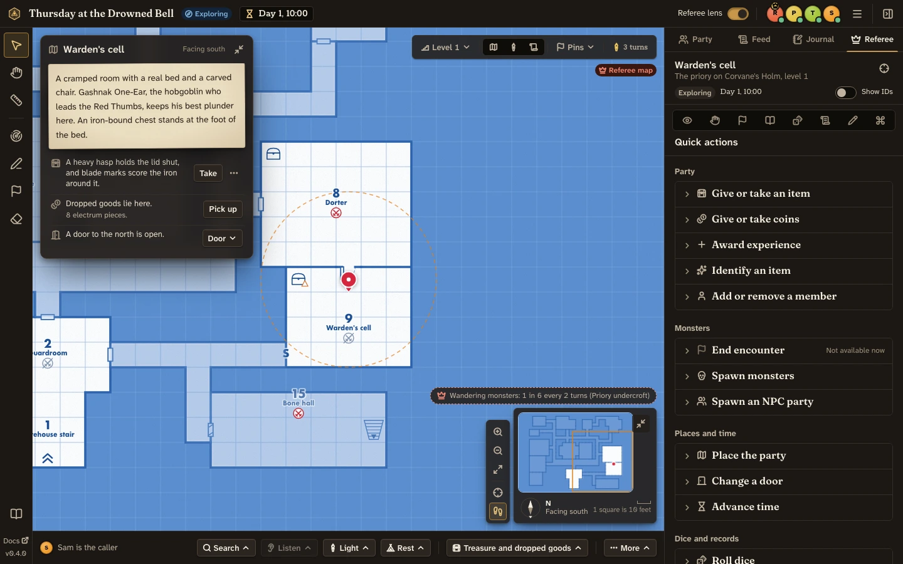

# Referee

The referee runs the adventure. You create the table, choose the adventure, set the rules, start the game, and then decide what the rules engine leaves to you. The [player guide](play.md) describes the screens that you share with your players, and the [host guide](host.md) covers the servers.

## Create a table

1. Open bxvtt and type your name.
2. Under **Create a table**, type a table name and select **Create table**. If the server needs a host key, the page asks for it. Type the key and select **Create table** again.

You are the table's referee, and the lobby opens. A table always keeps at least one referee.

## Set up the lobby

### Invite players

In **Invite players**, select **Copy** and send the link. Anyone who has the link can join as a player. If a link leaks, select **Make a new link**, and the old one stops working. Every member can see the invite code, so treat it as shared with the whole group. To let players on other networks join, read the [host guide](host.md#share-a-table-over-the-internet).

### Choose an adventure

Under **Adventure**, select one of the adventures. Only you see this choice until the game starts.

- **The Barrow of the Forgotten King** comes with bxapi.
- **The Drowned Bell** and **The Toll at Crookback Bridge** come with bxvtt. Each card shows the recommended party and the hooks that you can read to your players.

To add your own, select **Upload an adventure** and pick a JSON file of up to 8 MB. bxapi checks the file. If it finds a problem, the page names the problem. If the file is valid, the page says **X is a valid adventure**, where X is its name. Select **Upload** to add it to this table's list. The [adventures guide](adventures.md) covers the format and the other ways to add an adventure.

### Choose optional rules

Select **Optional rules** to open the panel. The table plays the standard B/X rules until you change a rule, and you change rules before you start the game:

- **Encumbrance** is **None**, **Basic**, or **Detailed**.
- **Experience awards** is **On returning to town** or **As soon as it is earned**.
- Switches turn on **Variable weapon damage**, **Individual initiative**, **THAC0 arithmetic**, **Weapon reload**, **Big monsters count as magical**, **Saving throws for magic items**, **Hunger and thirst penalties**, **Area spells catch allies**, **Passage width limits melee**, **A failed trap removal springs the trap**, and **Reroll low first-level hit points**. Each switch has a one-line description.

The **Start the game** panel summarizes the adventure, the number of characters, and the rules.

### Seats and the caller

When you start the game, bxvtt seats each character with the player who made it. The owner of the first character becomes the caller, the player who speaks for the party, unless you chose another caller. You play every character whose seat is empty.

**Table settings** holds these choices:

- **Who moves the party**: **The caller** or **Anyone with a character**. The second suits a small or casual table.
- **Caller**: one member, or **No caller**.
- **Resolve battle rounds automatically**: on by default. Turn it off to have the caller or you resolve each round.
- **Save automatically**: on by default.

You can change all of these during the game. In the table menu, **Table settings** shows the same options, and **Seats and caller** lets you choose the caller and, for each character, **Who plays** that character. Choose **Empty seat (the referee plays)** to take a character back.

### People and roles

In the lobby, **People at the table** lists everyone. Open **Actions for** a person to choose **Make a referee** or **Remove from the table**. Removing someone also replaces the invite code, so that person can't rejoin with the old link. The play screen has no member list, so do this work in the lobby, between games.

### Start the game

Add at least one character, choose an adventure, and select **Start the game**. Players can add or remove their own characters until then. The order in **Party** is the marching order, and you can change it with the arrows.

## The referee lens

Your top bar has a **Referee lens** switch (Shift+L). With the lens on, you see what a referee sees:

- The map shows the whole adventure, including rooms the party hasn't found, with a **Referee map** badge and markers for monsters, treasure, and traps. The level selector lists every level.
- A **Referee** tab appears in the dock.
- Referee-only choices appear in menus and forms, such as **Only referees see this pin**.

With the lens off, you see the table exactly as a player does, and the referee tools are hidden. Turn it off when you also play a character and want to avoid spoilers. The lens changes only what your screen shows. The server still sends your browser the referee data.

## The referee panel

Select **Referee** in the dock to open the panel. Its header shows the room where the party stands, the mode, and the clock. Icon tabs under the header select a section.

| Section | What it holds |
| --- | --- |
| **Here and now** | The room's description, its features, and notes for the level. It shows the wandering monster rule, such as `1 in 6, checked every 2 turns`, with the encounter table. During an encounter, it lists each monster group with its hit points and the **End it** choices. |
| **Quick actions** | One-click forms for the things that referees do most. The list follows this table. |
| **Quests, flags, and triggers** | Each quest with its objectives, which of them the players can see, and what completes them. Buttons reveal a hidden objective, mark an objective or a quest done, and **Give** each reward. It also lists the flags that the adventure sets and the triggers that fire. |
| **The adventure key** | Every level's rooms with markers for **Monsters**, **Treasure**, **Trap**, **Party**, and **Unvisited**. |
| **Generators** | Rolls for **Treasure**, **Monsters**, **Room**, and **NPCs**. The rolls stay out of the game and its log until you act on one. |
| **The log behind the screen** | The full event log, including the events that only referees see. |
| **Private notes** | Notes that only referees read. They save as you type, hold up to 50,000 characters, and stay with the table between games. |
| **Every referee command** | A form for each command that bxapi offers a referee, built from the command's rules. The commands you can send now come first. |

**Quick actions** groups its forms:

- **The party**: **Give or take an item**, **Give or take coins**, **Award experience**, **Identify an item**, and **Add or remove a member**.
- **Monsters**: **End the encounter**, **Spawn monsters**, and **Spawn an NPC party**.
- **Places and time**: **Place the party**, **Change a door**, and **Advance time**.
- **Dice and records**: **Roll dice**, **Add a journal entry**, and **Record a note**.

A form that can't apply now says so. **End the encounter**, for example, says **Not now** when no encounter is open. A quest gives nothing by itself, so you hand out each reward when the party earns it.

## Common situations

### The party talks its way past monsters

When the players parley and you decide that the monsters let them pass:

1. Open **Referee**, then **Here and now**.
2. Under **End it**, choose how the encounter ends:
   - **The monsters and the party came to terms** settles the matter for good. The monsters don't appear again when the party returns.
   - **A parley for now** lets the party pass. The monsters are back the next time the party enters their area.
   - **One side walked away** fits a party that left, or a pursuit that you called off. The monsters keep their area.
3. Select **End the encounter**.

**Quick actions** has the same form under **End the encounter**.

### Grant treasure

1. Open **Quick actions**.
2. Select **Give or take coins** for coin, or **Give or take an item** for an item.
3. Choose **Give coins** or **Give an item**, then the **Receiver**. For coin, enter the amounts. For an item, choose the **Item** and the **Quantity**.
4. Select **Grant coins** or **Grant item**.

For a quest reward, open **Quests, flags, and triggers** and select **Give** beside the reward. Treasure that the party finds in the dungeon needs nothing from you, because the players take it from the map.

### Fix a mistake

Choose the smallest tool that undoes the mistake:

- Wrong coins or a wrong item: use **Give or take coins** or **Give or take an item** with **Take coins** or **Take an item**.
- A door in the wrong state: use **Change a door**.
- A party in the wrong place: use **Place the party**.
- Time that passed by mistake: you can move the clock forward with **Advance time**, but you can't move it back.
- Anything bigger, such as a battle that went the wrong way: restore the autosave from before the battle. See [Saves and restoring](#saves-and-restoring).

### Move the party

1. Open **Quick actions** and select **Place the party**.
2. Choose **An area**, **A cell**, or **Town**.
3. For an area, choose the area. The party lands on the cell nearest the middle of the area. For a cell, click the cell on the map. Then choose the direction the party faces.
4. Select **Place the party**.

### Add or remove a character

Open **Quick actions** and select **Add or remove a member**. **Add a member** lists the characters that you made. **Remove a member** takes a member out of the party for good. After you add a character, open **Seats and caller** to say who plays it.

### A player is away

Open the table menu and select **Seats and caller**. For each of the player's characters, choose **Empty seat (the referee plays)** or another player. If the player was the caller, choose a new **Caller**. When the player returns, choose them again.

In a battle, you can declare for any character. Select **Resolve now** to resolve the round early. That declares **Hold** for every character who hasn't chosen.

### Roll in secret

In the **Feed** tab, select **Dice tray**, turn on **Secret roll**, and roll. You can also type `/roll secret 1d20`. Only referees see a secret roll. The **Generators** section and the **Roll dice** quick action also stay private until you use them.

## Saves and restoring

Any member can save the game. Open the table menu and select **Save the game** (Ctrl+S), or open **Saves**, type a name, and select **Save**. With **Save automatically** on, bxvtt also saves when the party enters a dungeon, reaches another level, meets monsters, or returns to town. It keeps the newest 10 autosaves. Each save lists its mode and game time.

To go back to a save:

1. Open **Saves**.
2. Find the save. **Hide autosaves** shortens the list.
3. Select **Restore** and confirm. Leave **Save the current game first** on to keep a way back to this moment.

Restoring starts a new game from the save. The table moves to it, and everyone keeps their seats. The **More for** menu on each save renames it, exports it, or deletes it.

To end a game, open the table menu and select **Return to the lobby**. The game ends and the saves stay, but the lobby has no way to restore one. End a game only when you are done with it. When the party wins or falls, the end screen lists the recent saves with **Restore**, and it offers **Return the table to its lobby**.

## Play alone

One person can be the referee and the whole party. Create a table, make characters in the lobby, and start the game. You play every character, you are the caller, and you hold every seat. Turn the **Referee lens** off with Shift+L to play without seeing the adventure's secrets, and turn it on when you need the referee panel.

## What bxapi decides and what you decide

bxapi enforces the rules. It decides whether a command is legal and rolls every die. It resolves attacks, damage, saving throws, morale, and reactions, tracks light and time, checks for wandering monsters, and keeps every game. It refuses a command that breaks a rule, and bxvtt shows the refusal to the player who sent it. You can't override a die or a rule from the panel.

You decide what the rules leave open:

- What a door, a room, and a rumor mean in the story, and what the monsters want.
- Whether a parley succeeded, and how an encounter ends when the party talks.
- Which rewards, treasure, and experience to give beyond what the game awards.
- How the table runs: who calls, which optional rules apply, and when to save.
- What a mistake costs, and how to repair it.
