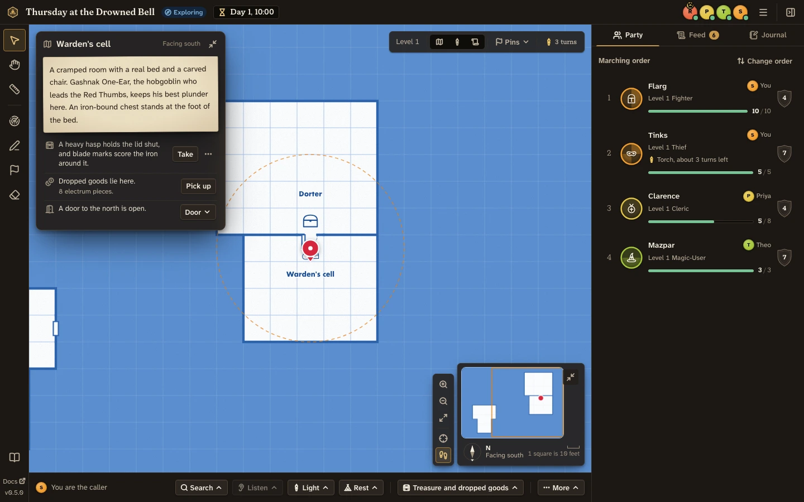

# bxvtt

bxvtt is a browser-based virtual tabletop for the 1981 B/X (Basic and Expert) fantasy adventure rules. A referee and players connect from their browsers to share a dungeon map, marching order, chat feed, character sheets, and rules compendium.

bxvtt pairs with [bxapi](https://github.com/mmacy/bxapi), a local HTTP rules server built on [osrlib](https://github.com/mmacy/osrlib-python). bxapi enforces the B/X rules, rolls every die, tracks time and light, and stores characters, adventures, active sessions, and saves. bxvtt manages the people at the table: browser identity, seats, real-time WebSocket sync, fog-of-war projections, battle declaration coordination, chat, map annotations, and referee tools.

## Choose where to start

- **Joining a friend's table as a player:** You do not need to install anything. Open the link from your referee in a desktop browser and read [Join a table and make a character](playing/getting-started.md).
- **Running a server for your group:** Install `bxapi` and `bxvtt` on your machine in [Quickstart](getting-started/quickstart.md), then publish your table with a free Cloudflare tunnel in [Play over the internet](getting-started/share-online.md).
- **Refereeing an adventure:** Configure optional rules, seats, and the caller in [Set up a table and lobby](refereeing/lobby-and-setup.md), then use the referee lens, adventure key, generators, and saves in [Run the game behind the screen](refereeing/running-the-game.md).
- **Playing or writing adventures:** Choose from the bundled modules or upload custom JSON dungeons in [Included and custom adventures](adventures/included-adventures.md), or script and play-test new dungeons in [Author and validate adventures](adventures/authoring-and-checking.md).
- **Maintaining a host machine:** Configure environment variables, back up databases, set up a permanent domain, and review security guarantees in [Run and maintain a server](hosting/running-a-server.md) and [Security and trust model](hosting/security.md).
- **Contributing or integrating:** Read [Architecture](architecture.md), set up the workspace in [Local development and testing](contributing/development.md), and browse the endpoints in [HTTP API, WebSocket, and SDK](reference/http-and-websocket.md).

## What bxvtt includes

- **Guided character creation** for all seven B/X classes (cleric, dwarf, elf, fighter, halfling, magic-user, and thief), with ability score adjustments, languages, starting spells, and equipment kits.
- **Full play loop** across town outfitting, temple healing, dungeon exploration, monster encounters, and simultaneous round-by-round battle declarations with event-by-event playback.
- **Strict server-side fog of war** that strips referee-only data before anything leaves the server, paired with a toggleable referee lens (`Shift+L`) so a solo player or referee-player can play unspoiled.
- **Shared dungeon canvas** in three visual themes (blueprint, torchlit, and parchment) with pings, freehand drawing, numbered note pins, distance measurement, and full keyboard navigation.
- **Built-in B/X compendium** covering classes, spells, monsters, equipment, magic items, languages, actions, and reference tables.
- **Three playable adventures** ready out of the box, plus JSON upload validation and an automated dungeon reachability and quest checker.
