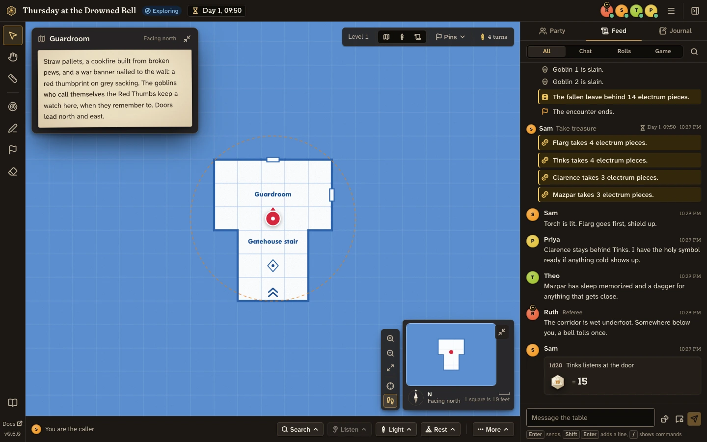
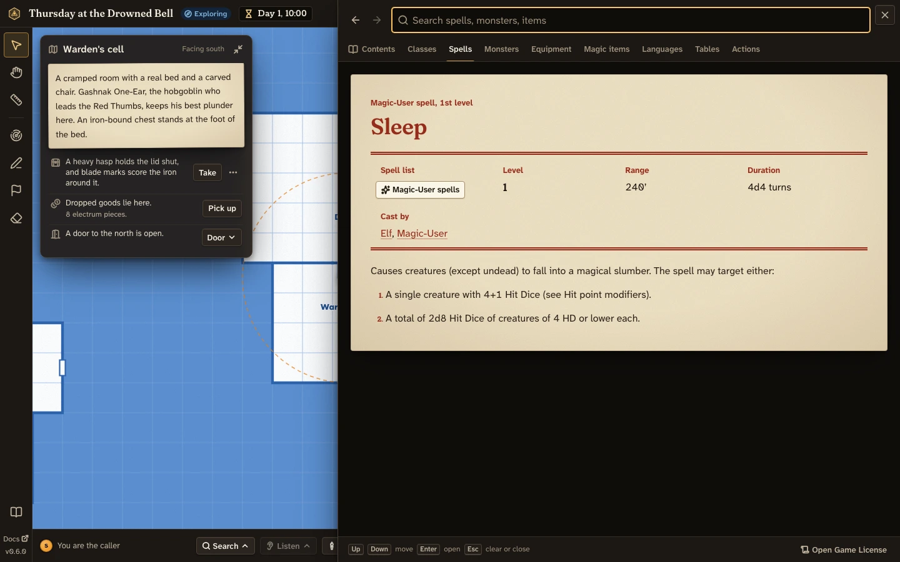

# Feed, journal, and rules reference

Use the right-hand dock and built-in rules compendium for communication, quest tracking, shared notes, and rules lookups inside the table window.

## Chat, whisper, and roll dice in the feed

Open the **Feed** tab (`Alt+2`) to read and post to the table's chronological log of chat messages, dice rolls, game events, and system notices. Unread entries display a count on the tab and a **New since you last looked** divider in the stream.

### Send messages and whispers

- Type in **Message the table** and press `Enter` to send, or `Shift+Enter` to insert a line break. Chat supports `**bold**`, `*italic*`, `` `code` ``, and `~~strikethrough~~`.
- Select **Whisper to someone** (the lock/whisper icon) to choose one or more recipients, or select **Every referee** to message the referee screen privately. Active whisper recipients appear as removable tags above the text box; select **Send to everyone** to return to public chat.

### Use slash commands and the dice tray

Type `/` at the start of the message box to open command autocomplete, or send `/help` (`/?`) to display command examples:

| Command | Example | Effect |
| --- | --- | --- |
| `/roll` or `/r` | `/roll 1d20+1 listen at the door` | Rolls `d4`, `d6`, `d8`, `d10`, `d12`, `d20`, `d100`, or `d%` on `bxapi` and posts the result with your optional label. |
| `/roll secret` or `/r secret` | `/roll secret 1d6 wandering check` | Referee only. Rolls dice visible only to referees. |
| `/w` or `/whisper` | `/w Ruth checking the chest` | Whispers to a named member, or use `/w referees <message>` to whisper to all referees. |
| `/help` or `/?` | `/help` | Toggles the inline slash-command reference card. |

To build rolls with buttons instead of typing formulas, select **Dice tray**:

1. Click a die (`d4`, `d6`, `d8`, `d10`, `d12`, `d20`, or `d100`). Clicking the same die again adds another die (up to 20); clicking a different die switches die size.
2. Adjust the **Dice** count and **Modifier** (`-99` to `+99`), and optionally fill in **What's it for?** (such as `to open the door`). Referees can also enable **Secret roll**.
3. Select the **Roll** button showing your formula (for example, **Roll 1d20** or **Roll 2d6+1**).

### Filter and search the feed

Use the segmented bar at the top of the feed to view **All**, **Chat**, **Rolls**, or **Game** entries (referees with the referee lens on also have a **Hidden** filter for secret rolls and referee events). Select **Search the feed** to filter loaded messages by text, or **Load older entries** at the top of the scroll area to page backward through earlier history.

## Track quests, chronicle entries, and shared notes

Open the **Journal** tab (`Alt+3`) to switch among three sub-tabs:

- **Quests:** Lists **Active quests** and **Completed** quests with their patron or quest-giver text and objective checklists. Hidden objectives appear automatically once discovered in play or revealed by the referee.
- **Journal:** Displays the adventure's opening narrative and dated entries added by game events and the referee, sorted **In order** or **Newest first** on parchment.
- **Notes:** Provides a shared **Party notes** scratchpad (up to 50,000 characters) editable by everyone at the table. Edits save automatically 1.2 seconds after you stop typing. If another member saves while you are typing, a conflict banner lets you choose **Keep mine**, **Take theirs**, or **See both** so neither edit is lost silently.

## Look up rules in the compendium

Open the B/X rules compendium at any time with the book icon at the bottom of the tool rail, **Rules reference** in the header or table menu, any linked item or spell name on a character sheet, or the `B` key.

- **Sections:** Browse **Contents**, **Classes**, **Spells**, **Monsters**, **Equipment**, **Magic items**, **Languages**, **Tables**, and **Actions**, or select **Open Game License** in the footer to read the OGL 1.0a text.
- **Search and facets:** Search from the top search bar on any page by name, body text, spell level (`3rd level`, `level 3`, `l3`), or monster Hit Dice (`4 hd`, `hd 4`). Individual tabs also provide dedicated filters for spell list and level, monster HD/alignment/category, equipment type, magic item category, and game mode.
- **Navigation keys:** Inside the open compendium, press `/` to jump to the search box, `Alt+Left` and `Alt+Right` to move back and forward through viewed pages, and `Esc` to clear an active search or close the drawer.
- **Spoiler protection:** Magic item entries reveal unidentified effects and curses. Players see a spoiler warning banner first and must select **Show magic items** to view them.

## Keyboard shortcuts

Press `?` on any screen to list the shortcuts currently active. Single-key shortcuts never fire while you are typing in an input or text area. On macOS, use `Cmd` in place of `Ctrl` and `Option` in place of `Alt`.

### General and panels

| Keys | Action |
| --- | --- |
| `?` | Show active keyboard shortcuts. |
| `Ctrl+K` | Open the command palette to search and run actions. |
| `B` | Open or close the rules reference. |
| `Ctrl+S` | Save the game immediately. |
| `Alt+1`, `Alt+2`, `Alt+3` | Open the **Party**, **Feed**, or **Journal** dock tab. |
| `Alt+4` | Open the **Referee** dock tab (referee with referee lens on). |
| `Shift+L` | Turn the referee lens on or off (referee only). |

### Map tools

| Keys | Action |
| --- | --- |
| `V` | Select and move tool. |
| `H` | Pan the map tool (`Space`+drag or `Shift`+arrow keys also pan). |
| `R` | Measure distance tool. |
| `P` | Ping tool (`Alt`+click also pings in any tool). |
| `D` | Freehand draw tool. |
| `N` | Pin a note tool. |
| `E` | Erase strokes tool. |
| `Esc` | Clear a measurement or cancel map picking. |

### Town and dungeon exploration

| Keys | Action |
| --- | --- |
| `O`, `T`, `M` | In town: open **Outfitter**, **Temple**, or **Treasure buyers**. |
| `Shift+R`, `G` | In town: open the **Rest** menu, or **Set out** for the dungeon. |
| `Arrow keys` | While exploring: move and face one square in that direction. |
| `Alt+Arrow keys` | While exploring: turn to face that direction without moving. |
| `S`, `L`, `T`, `Z` | While exploring: **Search**, **Listen**, **Light**, or **Rest**. |
| `G`, `U`, `M` | While exploring: **Treasure**, use stairs/transitions, or open **Other**. |

### Encounters and battle

| Keys | Action |
| --- | --- |
| `T`, `W`, `Shift+F`, `F` | In an encounter: **Talk**, **Wait**, **Flee**, or **Fight**. |
| `A` | In battle: apply the suggested action for your next undeclared character. |
| `Shift+A` | In battle: repeat last round's declarations for all of your characters. |
| `1` to `9` | In battle: open the action composer for your first through ninth character. |
| `Ctrl+Enter` | In battle: resolve the round (when automatic resolution is off). |
| `Esc` | Skip combat playback, or dismiss the aftermath card. |
