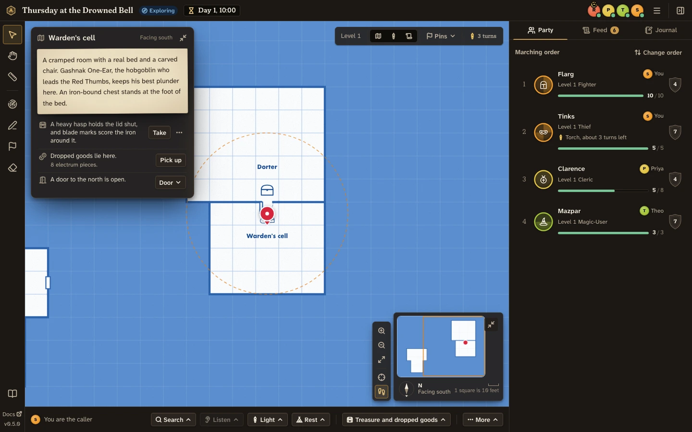

# Explore the dungeon

Once the party enters a dungeon, the central stage displays the explored map in **Exploring** mode. Each grid square measures 10 feet across, and the map reveals only cells and doors the party has discovered.

## Read the map and controls

- **Party token:** A red circular token marks the party's square, with an arrow pointing in the direction the party faces.
- **Top-left toolbar:**
  - **Level selector:** Switches between dungeon levels the party has visited.
  - **Map themes:** Choose **Blueprint map**, **Torchlit map**, or **Parchment map**. Your choice applies only to your own browser.
  - **Pins:** Lists every note pin placed on the current level, with buttons to center on a pin, read it, or **Add a pin where the party stands**.
  - **Light status:** Shows remaining light duration (such as `6 turns`), **No light** (`The party has no light.`), or **Darkness** (`Magical darkness covers the party.`). Click this button at any time to light a torch or lantern or put out an active light.
- **Scene panel (top-left, below toolbar):** Shows the name and description of the room the party occupies (or **Corridor** in unkeyed passages) alongside party facing and what the party perceives here: treasure caches with their descriptions, stairs, trapdoors, chutes, and passages, dropped goods, doors, and known traps, each with its action. A stairway says which way it leads, and a trapdoor, chute, or passage says what it is, but none says where it takes the party. A known trap says whether the party found it, it sprang, or a thief disarmed it, without saying what sets it off. The description collapses automatically after 10 seconds or when you click the map; select **Show description** or **Hide description** to keep it expanded or tucked away.
- **Bottom-right camera controls and minimap:** Use **Zoom in**, **Zoom out**, **Show the whole map**, **Center on the party**, and **Follow the party** (which tracks the party automatically until you pan manually), plus the collapsible minimap and compass.

## Move, turn, and track time

If you are the caller (or if **Anyone with a character** is enabled), move the party one 10-foot square at a time:

- **Move and face:** Press an arrow key, or click an adjacent square with the **Select and move** (`V`) tool. Walls and closed doors block movement.
- **Turn in place:** Hold `Alt` (`Option` on macOS) and press an arrow key to change the direction the party faces without stepping forward.
- **Pan the camera:** Hold `Shift` and press an arrow key, hold `Space` and drag, middle-click and drag, or switch to **Pan the map** (`H`).

Dungeon actions advance the game clock in the top bar. Torches last 6 turns (1 hour), lanterns last 24 turns (4 hours) per flask of oil, `bxapi` rolls periodic wandering monster checks as turns pass, and B/X rules require the party to rest for 1 turn (`Z`) every 6 turns of dungeon exploration.

## Exploration actions

| Action | Shortcut | What it does |
| --- | --- | --- |
| **Search** | `S` | Choose secret doors, room traps, or construction tricks, then pick the character who searches. |
| **Listen** | `L` | Listen for sound behind a closed door adjacent to the party's square (works on any side of your square, regardless of facing). |
| **Light** | `T` | Light a torch or lantern, set fire to dropped oil, or put out a character's light. |
| **Rest** | `Z` | Rest for one turn, a night, or a full day inside the dungeon. |
| **Treasure** / **Dropped goods** | `G` | Appears when a visible treasure cache or dropped monster pile is in reach. |
| **Go down the stairs** / **Climb the stairs** | `U` | Appears when the party stands on stairs, a trapdoor, or a chute between levels. |
| **Return to town** | none | Appears when the party stands on the dungeon entrance cell. |
| **Other** | `M` | Change facing, open character sheets to equip/drop/give items, reorder the party, prepare or learn spells, cast a spell, or use an item. |

Right-click any square, wall, or door on the map (or press `Shift+F10` with the map focused) to open a context menu with the actions valid at that spot.

### Doors

Stand next to a door and click it on the map, right-click it, or open the **Door** menu in the scene panel:

- **Open door** or **Close door** for unlocked, unstuck doors.
- **Force door** to have a party member shoulder a stuck door (each member's `X in 6` chance is listed).
- **Pick lock** to have a thief attempt a locked door with thieves' tools.
- **Listen at door** to spend a turn listening for monsters beyond.
- **Wedge shut with a spike** or **Wedge open with a spike** using iron spikes.

### Treasure and traps

A treasure cache appears in the scene panel with its description as soon as the party can see it, before anyone opens it, and stays listed after it's emptied. The description says what the cache looks like, not what it holds. When the party sees a cache or stands over loot dropped by defeated monsters, open **Treasure** (`G`):

- **Take treasure** divides coins and valuables across the party, whereas **Give all to one member** assigns the cache to one character.
- **Check for traps** lets a thief inspect a cache that has no known trap, and **Disarm trap** lets a thief attempt removal once the party has found one, before anyone touches the cache. The game never says whether a cache has a trap that the party hasn't found.
- **Pick up dropped goods** collects coins and gear left behind on the floor after a fight.

## Collaborate with map tools

Switch tools from the left-hand tool rail or by pressing their single-letter shortcuts:

- **Select and move** (`V`): Click adjacent squares to step, click doors or features to act, and drag to pan.
- **Pan the map** (`H`): Drag the map freely without clicking cells or doors.
- **Measure** (`R`): Drag from square to square to measure distance in squares and feet. Measurements appear only on your screen.
- **Ping** (`P`): Click any spot to pulse a ring in your player color for everyone at the table (`Alt`+click or long-press works from any tool).
- **Draw** (`D`): Drag freehand lines in your player color, visible to everyone on mapped levels until erased.
- **Pin a note** (`N`): Place a numbered pin with a note up to 280 characters that anyone can read on hover or from the **Pins** menu.
- **Erase** (`E`): Click or drag across drawings to remove them. Players erase strokes they drew; referees can erase any stroke or clear a level.

### Use map tools from the keyboard

When you focus the map canvas while using **Measure** (`R`), **Ping** (`P`), or **Pin a note** (`N`), a highlighted cell cursor appears at the party's square:

- Press the **arrow keys** to move the cursor cell by cell (the map announces rooms, doors, and relative coordinates to screen readers).
- Press `Enter` to drop a ping, create a pin, or start and finish a ruler measurement.
- Press `Esc` to clear a measurement or hide the cursor.
