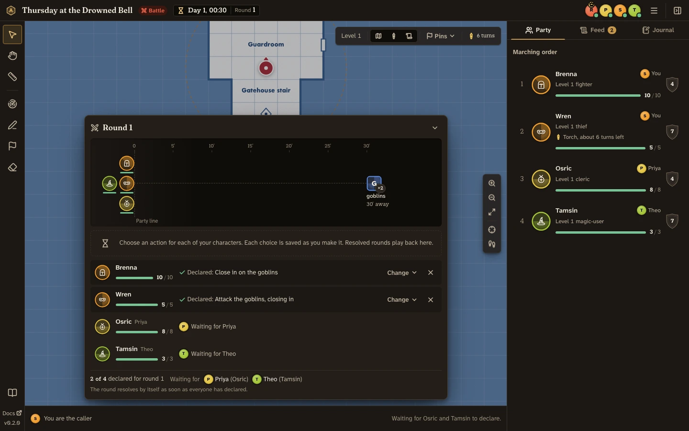

# Encounters and battle

When the party meets monsters in a room or corridor, the mode switches to **Encounter**. If a fight breaks out, the mode switches to **Battle**.

## Respond to an encounter

The encounter panel displays the monster groups, their distance in feet, any surprise or pursuit status, and their initial reaction (**Attacking**, **Hostile**, **Uncertain**, **Indifferent**, or **Friendly**).

The caller chooses how the party responds:

- **Talk** (`T`): Attempt parley to shift the monsters' reaction. Selecting **Talk** in the panel lets you choose which character speaks; pressing `T` or clicking **Talk** on the action bar uses the member with the highest reaction bonus. If conversation settles the encounter peacefully, the referee concludes it from the referee panel.
- **Wait** (`W`, or **Keep running** during pursuit): Spend a round holding position while the monsters act on their disposition.
- **Flee** (`Shift+F`): Attempt to evade before combat begins. Selecting **Flee** in the panel offers **Just run**, **Scatter coins**, or **Drop food** to distract pursuing monsters.
- **Fight** (`F`, or **Turn and fight** during pursuit): Engage and start a battle round.
- **Turn undead**: Available in the encounter panel when a cleric (or other turning class) confronts undead. You can use it if you control any character who can turn undead, not only the first one in the marching order.

Individual players can also **Use an item**, **Give items**, or **Drop items** (`Drop bait` during pursuit) from the encounter panel before the caller commits the party.

## Declare actions in battle

B/X battles resolve simultaneously round by round. Each round, you choose an action for each of your characters. Your choice is saved the moment you pick it, and you can change it until the round resolves. The round resolves when everyone has declared (with automatic resolution on) or when the caller or the referee resolves it.

A range track at the top of the battle board shows the distance from the party line to each monster group, and the declaration list below it shows every character who can act this round. A group that breaks and runs stays on the track, marked as fleeing, and you can still aim at it until it escapes the battle. Once anyone has declared a move, the track also marks where each character will stand after the declared moves. Party members see one another's declarations in real time, so the group can coordinate targets, spells, and movement.

### Declare with the suggested action or the full choices

Each of your characters' rows says **Not declared yet** until you declare, and **Declared:** followed by the action once you have. Every way of declaring below saves the declaration the same way, with no confirmation step:

1. Select the suggested action on a character's row to declare it. The suggestion depends on the character's rank, equipment, and class, and the action bar offers the same choice for your next undeclared character as **Declare for** followed by the character's name (press `A`):
   - **Already in melee:** Attacks the engaged monster group with the character's wielded weapon (for example, **Attack the goblins with a sword**).
   - **Ranged weapon in range:** Shoots or throws at the nearest group in range (for example, **Shoot at the goblins with a shortbow**).
   - **Caster with memorized spells:** **Choose a spell**, which opens that character's **Cast** tab instead of declaring.
   - **Armoured non-caster front-rank fighter:** Closes in and attacks (such as **Attack the goblins with a sword, closing in** or **Close in on the goblins**).
   - **Back-rank or unarmoured characters without a ranged attack or spell:** Defaults to **Hold** so a quick keypress never sends unarmoured characters or casters charging into melee.
2. For any other tactic, select **Actions** on the character's row (or press `1` through `9` for your first through ninth character) to open the action composer. The composer states that choosing an action declares it, and choosing a tile or a button there saves the declaration at once:
   - **Attack:** Pick a target group, switch weapons, or enable **Back-stab** for a thief on a surprise free round or while the thief is hiding.
   - **Cast:** Choose a memorized spell and aim at monster groups, specific individual monsters (such as `Goblin 2`), or party allies.
   - **Move:** Choose **Close in** on a monster group, **Fighting withdrawal** (step back out of melee defensively), **Retreat** (flee melee at full speed), or **Trade places** with another party member between ranks.
   - **Item:** Drink a potion, read a scroll, throw oil or holy water, or activate a magic item.
   - **Hide:** A character with thief skills can choose **Hide in shadows** instead of acting. A character can't hide in the front rank, and the board says at once if the declared moves would leave the character there. The referee rolls in secret, so the board never says whether a hide worked. A **Hiding** badge on the character's row shows who is hiding, and a hiding thief can back-stab from outside the front rank. The board says when a back-stab won't work.
   - **Give**, **Turn undead**, and **Hold**.
   - When facing a monster with a petrifying gaze, a **Guard against the gaze** selector lets you choose **No guard**, **Avert eyes**, or **Watch in a mirror**.
3. Starting in round 2, select **Declare same as last round** (`Shift+A`) to declare your previous actions again for every eligible character you control, or select the repeat icon on a single character's row.
4. To change a declaration before the round resolves, select **Change** on the character's row. The composer highlights the saved choice, and choosing another one replaces it. Select the clear button (`X`) to remove the declaration.

### See who still has to declare

The footer of the battle board counts the declarations for the round being declared (for example, **1 of 4 declared for round 2**), lists who is still to declare by player and character, and states what starts the round:

- With **Resolve battle rounds automatically** on (the default), the round resolves by itself as soon as everyone has declared.
- With automatic resolution off, the footer names the caller, and the caller or the referee selects **Resolve round** (`Ctrl+Enter`, or `Cmd+Enter` on macOS) once everyone has declared.
- If the rules engine would refuse a declaration, the footer names the characters who have to choose another action, and the round waits for them, with automatic resolution on or off.

Once you have declared for all your characters, the action bar names the characters the table is still waiting for.

## Resolve the round and watch playback

A referee can also select **Resolve now** to resolve the round before everyone has declared. Every character without a declaration holds that round, and a declaration that someone already made is never replaced.

### See why a declaration won't work

Each time a declaration changes, the server asks `bxapi` to preview the round, so a row shows why a declaration won't work before anyone resolves it. For example, a thief who declares **Hide in shadows** from the front rank, a spell with the wrong number of targets, or an attack out of reach shows the reason on that character's row, and the player can pick a valid action. A refused declaration stays saved, because another character's declared move can make it legal, and the note disappears when that happens. The round doesn't resolve while a declaration is refused. If the preview isn't available, no notes appear, and `bxapi` still refuses an illegal round when it resolves, naming the character whose declaration it refused.

### Watch playback

Once `bxapi` accepts the round, it rolls initiative, movement, attacks, damage, saving throws, spells, and morale checks, and the battle board plays the round back one beat at a time. The playback strip narrates each roll, and the range track and the party panel follow the hit points and conditions of the beat on screen. Each beat stays up long enough to read: a short line lasts about a second, an attack with its roll about two and a half seconds, and a death or a spell holds a moment longer.

Playback runs separately in each browser, so pausing or slowing yours never holds up anyone else. Use the controls on the strip to set your own pace:

- **Pause playback** (`K`) holds the beat on screen, and **Resume playback** (`K`) continues from it.
- **Step back** (`,`) and **Step forward** (`.`) move one beat at a time and pause there. Stepping back from the first beat of a round reaches the round before it.
- **Playback speed** offers **Slow**, **Normal**, **Fast**, and **Very fast**. Your browser remembers the speed you choose.
- **Skip** (`Esc`) jumps to the end of the round, where the strip sums it up.
- **Replay** on the summary plays the last round again. Pressing `,` at the summary steps back into the last beat of the last round.

You can declare for the next round at any time, even while your playback is running or paused. The heading of the board names the round that's playing, and the footer names the round being declared. If the next round resolves while your playback is paused, the strip moves to the start of the new round and stays paused, and stepping back reaches the round you were watching.

If your operating system is set to reduce motion, rounds don't play back by themselves, and the strip shows each round's summary at once. **Replay** then starts paused on the first beat, so you can step through the round.

## Aftermath and end of the game

When a fight concludes and play returns to exploration, an aftermath summary card (titled, for example, **The goblins are beaten** or **The party got away**) lists defeated monsters, experience earned, fallen party members, and items left behind:

- Select **Pick up dropped goods** or **Take treasure** directly on the card to collect floor loot or caches. **Take treasure** appears once a cache has no known trap, or its trap is sprung or removed. (Under standard B/X rules, earned XP is awarded when survivors return to town.)
- Select **Replay last round** to rewatch the decisive round, or **Close** (`Esc`) to dismiss the card.

If the party completes an adventure's concluding quest, the **Victory** screen displays the closing narrative, total game time, completed quests, and final party roster. If every party member dies, **The party has fallen** (`Game over`) appears instead. On either end screen, the referee can restore a recent save to continue playing or select **Return the table to its lobby** to start fresh.
