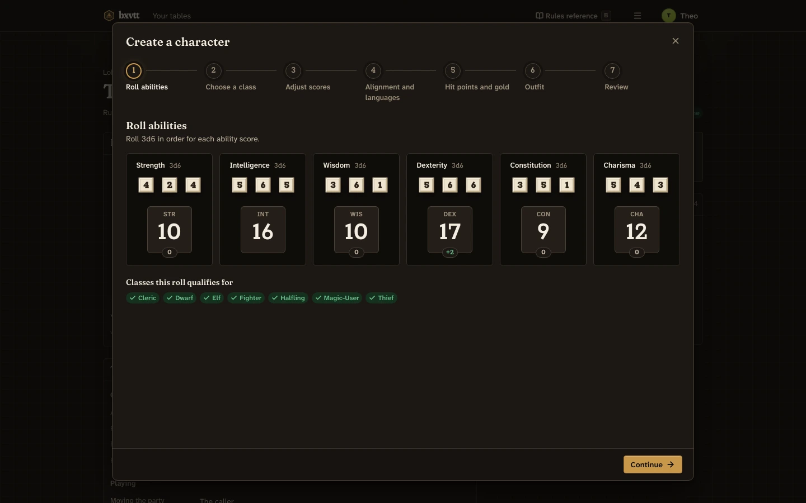
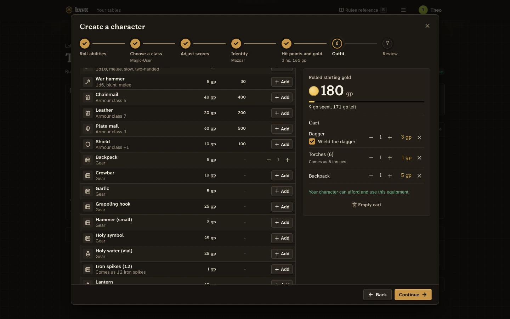
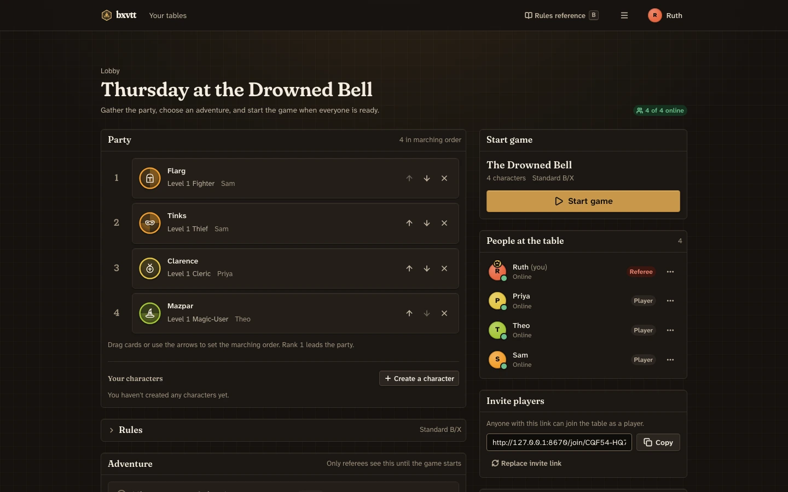

# Join a table and make a character

You play bxvtt in any current desktop browser with a window at least 820 pixels wide. You do not install software or create a password-protected account.

## Join a table

How you join depends on what your referee sent you:

- **Direct invite link:** Open the link (ending in `/join/...`), enter your display name under **You're invited to a table** (or **I'm new here**), and select **Join the table**.
- **Separate server URL and invite link or code (first-time players only):** Open the server URL, enter your display name under **Pick your name**, and select **Continue**. Paste the invite link or 20-character code into **Join a table** and select **Join** to open the table immediately.

Your browser saves a secret user token for that server's web address (origin). Keep using the same browser on the same device so bxvtt recognizes you automatically.

## Rejoin when the URL or browser changes

If your host uses `npm run share`, the public `trycloudflare.com` URL changes between sessions. Because your browser ties your sign-in token to the previous web address, the new URL will not recognize you automatically. The same happens if you switch computers, switch browsers, or clear site data.

Do not pick a name on the server's home page or under **I'm new here**, which creates a separate duplicate profile. Reclaim your existing member identity instead:

1. Open the full `/join/...` invite link on the new server URL directly (before entering a name on the home page).
2. Under **I've played at this table before**, select your previous name.
3. Keep the **Waiting for a referee to let you in** page open and let your referee know by voice or chat. Your request remains active for up to 5 minutes while the page stays open, and **Stop waiting** cancels it immediately.
4. Once a referee selects **Let them in**, your browser receives a new sign-in token and opens the table with all of your characters, seats, and permissions intact.

Reclaiming your identity retires your previous browser's token. If you later open the older browser tab, bxvtt displays **You've signed in from another browser** so you know why that tab was disconnected.

## Sign out or delete your profile

Select your name at the top right of the home page, the join page, or the lobby to open **Your profile**. Below the name and color, you find two buttons:

- **Sign out:** This browser forgets you, and the server stops accepting its token. Your tables, characters, and seats stay as they are. Because bxvtt has no passwords, choosing your name again creates a new profile. To come back as yourself, open a table's invite link, choose **I've played at this table before**, and ask a referee there to let you in. A referee can come back this way only at a table with another referee, and a person who isn't at any table can't come back at all (choose **Delete profile** instead to remove your profile and characters from the server). The **Sign out of this browser?** dialog lists which of your tables you can come back to before you confirm.
- **Delete profile:** bxvtt deletes your profile and every character you made, and takes you out of every table as **Leave table** would. A table where you're the only member is deleted with its saved games. At other tables, your seats become empty and the referee controls those characters, and your chat messages stay under the name **A former member**. You can't undo a deletion. If you're the only referee of a table where other people play, first make another member a referee, or delete the table from its table menu.

## Create a character

In the lobby, locate **Your characters** inside the **Party** panel and select **Create a character**. A six-step wizard opens. Your in-progress choices stay saved in your browser if you close the window; **Start over** discards them.

1. **Roll abilities.** Select **Roll ability scores**. `bxapi` rolls 3d6 in order for Strength, Intelligence, Wisdom, Dexterity, Constitution, and Charisma. Click the dice or select **Skip** to finish the animation early. **Classes this roll qualifies for** lists the classes your scores unlock. **Roll again** rolls a fresh set of six scores; ask your referee whether your table permits rerolls.
2. **Choose a class.** Select one of the seven B/X classes: **Cleric**, **Dwarf**, **Elf**, **Fighter**, **Halfling**, **Magic-User**, or **Thief**. Each card lists prime requisites (the key ability scores that adjust earned experience points), hit die, allowed weapons and armour, and special abilities, and any unavailable class states the scores it requires. Check **Reroll a first hit die of 1 or 2** at the bottom only if your referee enables that optional rule.
3. **Adjust scores.** Optionally lower Strength, Intelligence, or Wisdom by 2 points to raise your class's prime requisite by 1 point. No ability score can be lowered below 9. Select **Skip this step** if you make no trades. While you build a trade, a blue note says what to do next, such as raising a prime requisite to spend the points you gained. An amber warning means you chose something the rules don't allow, such as lowering Dexterity. Select **Continue** once the trade is valid. If you select **Continue** with a trade unfinished, the step stays open and tells you to finish the trade or reset it. **Reset to rolled scores** clears the trade.
4. **Identity.** Enter a **Name** (or select **Suggest a name**) and choose **Lawful**, **Neutral**, or **Chaotic** alignment, which grants your alignment tongue. Characters with Intelligence 13 or higher pick extra **Languages**, and Magic-Users and Elves choose the starting spell in their spell book.
5. **Outfit.** Spend your starting gold across **All**, **Weapons**, **Armour**, **Gear**, and **Ammunition**, or select the class kit button above the list (such as **Fill with the soldier kit** for a fighter or **Fill with the cutpurse kit** for a thief). Adding your first weapon, body armour, or shield checks its **Wield the ...** or **Wear the ...** box in the **Cart** automatically so your character starts equipped. Unspent gold stays in your purse for shopping in town.

   

6. **Review.** Verify your character summary (use **Change** on any section to jump back) and select **Create character**. `bxapi` rolls your starting hit points and creates the character. Select **Make another** to roll an additional character, or **Done** to return to the lobby.

Each character created in the wizard joins the **Party** list automatically. When the referee starts the game, each character on the roster becomes a **seat** (the link assigning control of that character during play to you).

## Wait in the lobby

Before play starts, everyone gathers in the lobby.

- **Party** displays the characters in marching order, where the top rows form the front rank. Select any character's name to inspect their sheet (and **Delete character** if you own them and want to remove them permanently). You can pull your own character off the roster with **Take out of the party** (for example, **Take Wren out of the party**), while the referee controls the final marching order.
- **Your characters** lists any characters you created earlier (or removed from the roster) that are not currently in **Party**. Select **Add to party** if a character is waiting here.
- **People at the table** shows everyone who joined, with a green indicator for members currently online.
- **Invite players** provides a **Copy** button for the table's invite link.
- **Table menu** in the page header contains **Leave table**. Leaving takes your characters out of the party, and you need the table's invite link to come back. You keep your characters for another table.
- **Table settings** displays who moves the party, who the caller is (the player designated to speak for the party), and whether battle rounds and autosaves run automatically.

While the referee selects the adventure and optional rules, your side column shows **Waiting for the referee to start** (plus a note if the table has saves from earlier sessions that the referee can restore). As soon as the referee starts or restores a game, everyone's browser transitions to the play screen automatically. Next, read [The table screen and town](table-and-town.md).
