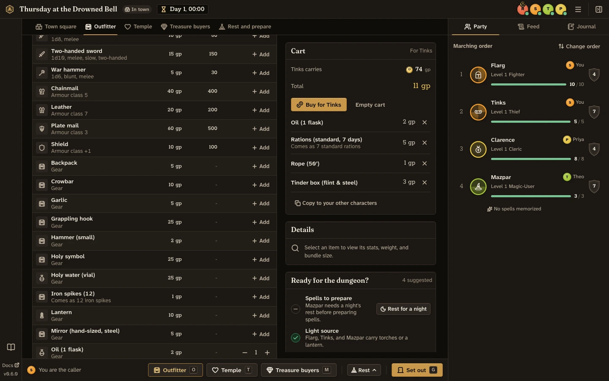
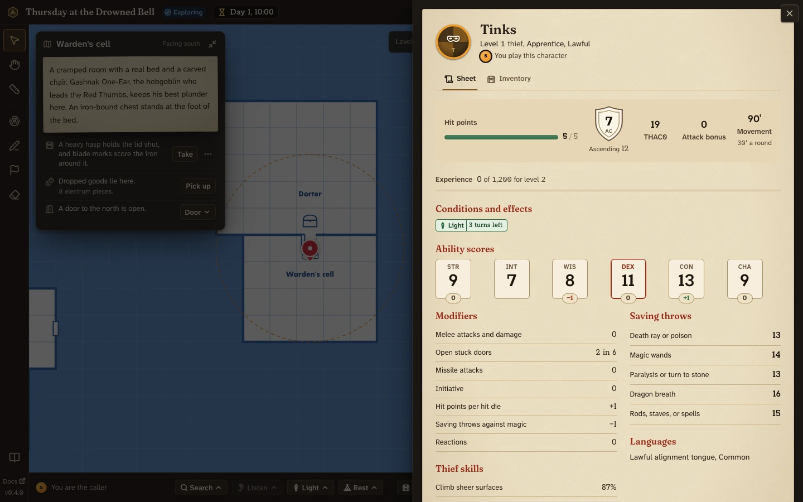
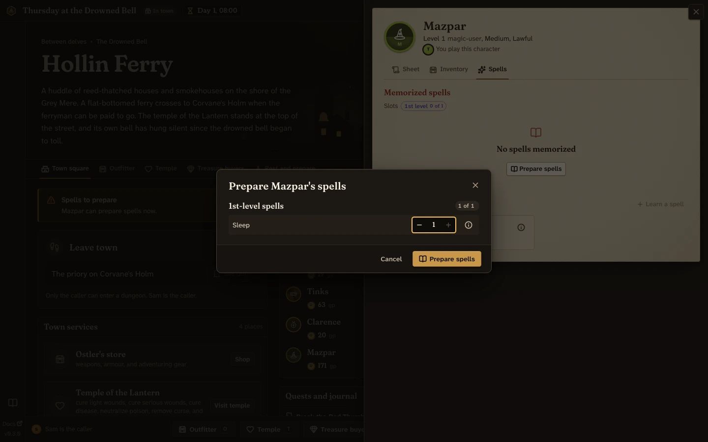

# The table screen and town

When the referee starts or restores a game, the play screen opens for everyone at the table.

## Tour the play screen

- **Top bar:** Displays the table name, mode badge (**In town**, **Exploring**, **Encounter**, **Battle**, **Game over**, or **Victory**), game clock (such as `Day 1, 00:30`, plus the round counter in battle), online avatars, and the **Table menu**. Use **Hide table panels** / **Show table panels** at the right end to collapse or expand the dock (on windows narrower than 1100 pixels, the dock becomes a drawer opened with **Open table panels**).
- **Tool rail (left):** Contains the dungeon map tools (shown while in a dungeon) and, at the bottom, **Rules reference** (`B`). Under the rail, **Docs** opens this documentation in a new tab, and the line below it shows the bxvtt version, such as `v0.3.0`. Every other screen shows the same two items in its bottom left corner.
- **Stage (center):** Displays the active scene for the current game mode: town services, the dungeon map, an encounter prompt, the battle board, or the end-of-adventure summary.
- **Action bar (bottom):** Displays who the caller is alongside contextual actions for the current mode. On narrower screens, buttons condense to icons and excess items move into **More actions**.
- **Dock (right):** Contains the **Party** (`Alt+1`), **Feed** (`Alt+2`), and **Journal** (`Alt+3`) tabs, plus **Referee** (`Alt+4`) for referees with the referee lens enabled.

Open the **Table menu** in the top bar for **Save game** (`Ctrl+S`, or `Cmd+S` on macOS), **Saves**, **Table settings**, **Copy invite link**, **Rules reference** (`B`), **Keyboard shortcuts** (`?`), **Command palette** (`Ctrl+K` or `Cmd+K`), **Your tables**, and **Leave table**. Referees also see **Seats and caller** (to assign who controls each character and who speaks for the party), **Return to lobby**, and **Delete table**. See [Leave or delete a table](../refereeing/lobby-and-setup.md#leave-or-delete-a-table) for what leaving and deleting do.

## Who controls what

bxvtt separates individual character actions from party-wide movement, following 1981 B/X table play:

- **Your seats:** You always control the characters seated with you. You buy and equip their gear, manage their inventory, prepare and cast their spells, and declare their actions in battle.
- **The caller:** By default, one player serves as the caller who speaks for the party. Only the caller (or a referee) moves the party on the map, opens doors, searches rooms, rests, takes treasure, sets marching order, and picks the party's reaction to encounters. The action bar states **You are the caller** or names the current caller. If your referee sets **Who moves the party** to **Anyone with a character**, every player with a seated character can perform party actions.

Any button you cannot use right now appears dimmed; point at it to read why.

### The party panel

Open the **Party** tab (`Alt+1`) to view all party members in marching order with their hit points, armour class, active light remaining (while in a dungeon), a **No spells memorized** marker on a caster who could prepare spells (while in town), and assigned player. Select the marker to open that caster's **Spells** tab. If you may act for the party, select **Change order** to reorder members by dragging, pressing arrow keys on a row's handle, or clicking the forward and back buttons, then select **Done**.

## Prepare in town

Between trips into the dungeon, each player buys and equips gear for their characters and prepares any spells, then the caller selects **Set out** (`G`) to travel to the dungeon. Navigate town services with the five stage tabs or the action bar shortcuts: **Town square**, **Outfitter** (`O`), **Temple** (`T`), **Treasure buyers** (`M`), and **Rest and prepare** (`Shift+R` opens the rest menu).

### Buy gear at the outfitter

1. Select **Outfitter** (`O`).
2. Under **Shopping for**, select the character buying equipment. Each button displays that character's available gold.
3. Search or filter items across **All**, **Weapons**, **Armour**, **Gear**, and **Ammunition** (prices are in gold pieces and weights are measured in coins, where 10 coins equal 1 pound). Select an item's name to inspect its stats, or select **Add** to place it in that character's cart.
4. Optionally select **Copy to your other characters** to copy the current cart to your other living characters.
5. Select **Buy for** that character (such as **Buy for Wren**, or **Buy all carts** when multiple characters have items queued). If a character lacks enough gold for their entire cart, `bxapi` rejects that purchase without spending anything. After buying weapons, armour, or a shield, use **Wear** or **Wield** followed by the item's name under **Equip now** on the confirmation card to equip it immediately.

The **Ready for the dungeon?** card checks whether the party has prepared spells (**Spells to prepare**), a light source, a tinder box, rations, and rope, with shortcuts such as **Find rope at the outfitter** that filter the shop. These reminders are advisory and never block departure.

### Heal and recover at the temple

1. Select **Temple** (`T`).
2. Choose a character under **Patient**.
3. Select **Buy** beside a temple service: **Cure light wounds**, **Cure serious wounds**, **Cure disease**, **Neutralize poison**, **Remove curse**, or **Raise dead**.

The entire party pools its coins for temple services: `bxapi` deducts the fee in whole gold pieces from the patient's purse first, then from the remaining party members in marching order. A fallen character with an empty purse can still be raised as long as the party has enough gold together. Referees also see an optional **Cleric level (optional)** input when an adventure or house ruling calls for a higher-level caster.

### Sell gems and jewellery

Select **Treasure buyers** (`M`) to appraise and sell gems and jewellery in the party's packs for full gold value. Choose individual items and select **Sell selected**, or select **Sell everything**; proceeds go into the purse of the character who had each piece.

### Rest and prepare spells

When a caster in the party has nothing memorized and could prepare spells, the town square shows a **Spells to prepare** banner. It names who needs a night's rest before preparing spells and who can prepare spells now, with a **Rest for a night** button and an **Open** button for each caster who can prepare (such as **Open Mazpar's spells**). While the banner shows, the **Spells to prepare** line of the readiness checklist shows only its status.

Select **Rest and prepare** (or press `Shift+R` for the quick rest menu) and choose a rest:

- **Rest for one turn:** A short break.
- **Rest for a night:** Sleep, so casters can prepare spells.
- **Rest for a full day:** Sleep, so casters can prepare spells, and recover hit points.

After a rest, the panel reports the game time that passed and the hit points each character recovered. Under **Spells and gear**, each character's row shows their level and class, and for a caster how many spells are in the spell book and how many are memorized, such as "Level 1 magic-user, 1 in spell book, none memorized". Select **Open** followed by the caster's name (or use the **Party** panel) to prepare spells on the character sheet.

### Leave for the dungeon

Select **Set out** (`G`), review any readiness reminders in the confirmation dialog, and select **Set out** again to travel to the dungeon entrance.

## Use the character sheet

Select any character in the **Party** tab to open their character sheet in a side drawer. Clicking any weapon, armour, item, or spell name inside the sheet opens its entry in the rules compendium.

- **Sheet:** Displays hit points, armour class, THAC0 (To Hit Armour Class 0), attack bonus, movement speeds, XP toward the next level, active conditions and light, ability scores with modifiers, saving throws, thief or class skills, and spoken languages.
- **Inventory:** Groups **Worn and wielded** items (each with **Unequip**), **Light** controls (**Light a torch**, **Light the lantern**, **Put out light**, and **Set fire to dropped oil**), **Pack** items, **Gems and jewellery**, and **Purse**. Select the three-dot **Actions for** menu on any pack row to **Equip**, **Use** (for magic items), **Give to…**, or **Drop…** directly from the sheet.
- **Spells (casters only):** The **Spells** tab appears for a character who has spell slots, a spell book, or memorized spells. See [Prepare, learn, and cast spells](#prepare-learn-and-cast-spells).

### Prepare, learn, and cast spells

The **Spells** tab lists **Memorized spells** first. A **Slots** row shows each spell level's slots and how many are filled, such as **1st level 1 of 2**. Each memorized spell has a card with its level, range, and duration, a **×2** badge when more than one copy is memorized, an **About** button for its full description, and a **Cast** button. A character with slots but nothing memorized shows **No spells memorized**, and a caster without slots yet, such as a 1st-level cleric, shows **No spell slots yet**.

To prepare spells:

1. Select **Prepare spells**. The dialog groups the spells the character can prepare by level, such as **1st-level spells**, and shows how many of that level's slots you have chosen, such as **1 of 2**.
2. Use the count beside each spell to choose how many copies to memorize. A spell with a reversed form has a second row with a **Reversed** badge, for a caster who chooses the form when memorizing. When a level's slots are full, its counts can't go higher and say "No 1st-level slots left."
3. Select **Prepare spells**. Your choices replace the spells the character has memorized now.

If the game refuses, for example because the party hasn't rested since the character last prepared, the dialog shows why.

A caster who keeps a spell book also has a **Spell book** section. Select **Learn a spell**, choose a spell in **Spell**, read its details, and select **Learn** followed by its name to write it into the book. When the character can't learn a spell now, the button is unavailable and says so.

To cast a memorized spell outside battle, select **Cast** on its card. When the spell can be cast more than one way, choose how in **How to cast**. Each way reads by what it targets, such as **One creature** or **By hit dice**, or, when two ways target alike, by the label that starts its description, such as **Conjuring light**. Then choose the target in **Target**, such as a party member or **Where the party stands**. A caster who chooses a spell's form when casting sees a **Cast** followed by the reversed spell's name and **instead** checkbox, and the dialog's title follows that choice. Select **Cast**.

An adventure can add spells of its own. They appear on the tab, in the dialogs, and in the **About** details like any other spell, but their names don't link to the rules compendium, which lists only the standard spells.
