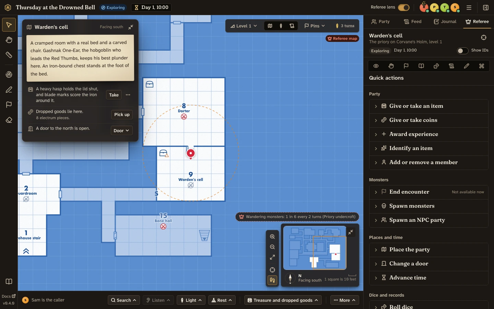

# Run the game behind the screen

During play, `bxapi` handles rules math and dice while you run the world, judge open-ended situations, and pace the session.

## What bxapi enforces and what you decide

`bxapi` validates every command, rolls attacks, damage, saves, reactions, and morale, advances the clock, burns torches, checks for wandering monsters, and rejects illegal actions with an explanation sent privately to the acting player. You cannot override an individual die roll after `bxapi` rolls it.

You decide everything outside strict mechanics:

- How NPCs and monsters speak, bargain, bluff, or surrender, and whether a parley ends an encounter.
- When to grant quest rewards, bonus XP, extra coins, or items.
- How to correct a misclick or table mistake (adjusting doors, placing the party, or restoring an autosave).
- Who serves as caller and who controls an absent player's characters.

## Toggle the referee lens (`Shift+L`)

Your top bar includes a **Referee lens** switch (`Shift+L`).

- **Lens on (default):** Displays the full dungeon map (including unvisited areas, secret doors, monster markers, treasure, traps, and `R1`/`R2` referee pins), adds the **Referee** tab (`Alt+4`) to the dock, reveals exact monster hit points and referee controls on encounter and battle overlays, and adds secret rolls and referee events (plus a **Hidden from players** filter) to the **Feed**.
- **Lens off:** Renders the table strictly as a player sees it, hiding unmapped rooms, referee pins, hidden feed entries, and referee tools so you can control a character without spoilers.

Turning the lens off changes only what your browser renders; the server still treats your account as a referee, and your seat and round-resolution permissions remain active.

### Play solo

One person can serve as both referee and the entire party. Create a table, roll a party of characters in the lobby, start the game, and press `Shift+L` to turn off the **Referee lens**. You hold every seat and act as caller while exploring unspoiled; press `Shift+L` only when you want to adjudicate a parley or grant a quest reward.

## Tour the referee panel

With the **Referee lens** on, select **Referee** (`Alt+4`) in the dock. A persistent status strip at the top shows the party's current location, mode, game clock, active encounter summary, a button to center the map on the party, and a **Show IDs** toggle that reveals internal entity IDs and `(x, y)` cell coordinates across every tab.

| Tab | Section title | What you can do |
| --- | --- | --- |
| **Now** | **Current location** | Answer what is here right now and act on it: inspect the current room's key, doors, traps, triggers, and wandering monster table, or manage active encounter monster HP and end the encounter with **End encounter**. |
| **Act** | **Quick actions** | Open streamlined forms grouped under **Monsters** (moved first during encounters), **The party**, **Places and time**, and **Dice and records**. |
| **Story** | **Quests, flags, and triggers** | Activate or complete quests, **Reveal** hidden objectives, **Mark complete** objectives, distribute quest rewards with **Give**, edit adventure flags, and inspect or **Mark fired** triggers. |
| **Key** | **Adventure key** | Search every dungeon level's rooms by name, text, or monster, see **Party**, **Monsters**/**Cleared**, **Treasure**, **Trap**, and **Unvisited** badges, center the map on any room, or **Place party here**. |
| **Roll** | **Generators** | Roll stateless **Treasure** (types A-V), **Monsters** (hit points), **Room** stocking, and **NPCs** parties. Rolls stay out of the game until you click **Give coins**, **Give**, **Spawn these**, **Spawn these monsters**, or **Spawn a party like this**, and **Same roll** repeats any result from its seed. |
| **Log** | **Referee log** | Inspect the referee events in the game's event log, filtered to **Referee only** or **All events**, by event category (**All categories** by default), or by search text. |
| **Notes** | **Private notes** | Write up to 50,000 characters of referee-only notes that save automatically 1.2 seconds after you stop typing (or immediately on `Ctrl+Enter` / `Cmd+Enter`) and persist with the table across games. |
| **All** | **Every referee command** | Search and submit schema-driven forms for all 23 `bxapi` referee commands, sorted with currently legal commands first. |

## Read what the players read and what only you read

Each treasure and feature in a room's key, under **Now** and **Key**, shows two texts:

- **Players read:** The feature's description, on the same parchment as the players' scene panel. Every player reads it once the feature comes into the party's sight, so it never names what a treasure holds or a trap the party hasn't found.
- **Referee notes:** What the adventure's author wrote for you alone, such as what a chest holds, whose money it is, or how its trap is hidden. Players never receive it.

A treasure also shows **Still here** or **Emptied** beside its label and lists its contents after the notes, and a trap shows **Not found**, **Found**, **Sprung**, or **Disarmed**. On the referee map, the tooltip of a treasure shows its description, what it holds (**Holds:**), the first 120 characters of its referee notes (**Referee notes:**), and **Unseen by the party.** until the party has seen it.

The scene panel always shows what the players see, even with the **Referee lens** on, so it never shows referee notes.

## Handle common table situations

### End an encounter peacefully or call off pursuit

When players talk their way past monsters or an encounter ends without a fight to the death:

1. Open **Now** (or select **End encounter** in **Act**, or expand **Monsters and referee tools** on the encounter panel).
2. Choose how the encounter concludes:
   - **Came to terms (mark area resolved):** Settles the room's encounter permanently so those monsters do not reappear on future visits.
   - **Temporary truce:** Ends the encounter, but leaves the area unresolved so the monsters are still there if the party returns.
   - **Broke off:** Ends a standoff or calls off pursuit without marking the room cleared.
3. Select **End encounter**.

### Award quest rewards, treasure, or experience

Completing a quest in `bxapi` never transfers items, coins, or XP automatically. When the party fulfills a quest:

1. Open **Story** (**Quests, flags, and triggers**) and expand the quest.
2. Mark objectives or select **Complete quest** if an automatic trigger has not already done so.
3. Choose the recipient beside each listed reward and select **Give**.

For ad-hoc awards at any time, open **Act** (**Quick actions**) and use **Give or take coins**, **Give or take an item**, or **Award experience** (which can award XP to **Every living member** or one character). `bxapi` has no command to conjure new gems or jewellery directly, so grant their value in coins or let the party loot placed dungeon caches.

### Teleport the party and handle skipped triggers

Moving the party with **Place the party** (in **Act**, or via **Place party here** in **Key**, or by right-clicking the referee map) teleports them without firing room-entry encounters or triggers. Immediately after placement in a keyed room, the panel says that placing the party skips room-entry effects and offers one-click buttons to spawn the room's monsters (**Spawn** followed by the monsters' name), **Fire trigger**, or start, reveal, or complete matching quest objectives.

### Cover for an absent player

Select **Seats and caller** in the **Table menu** and set each absent player's character to **Empty seat (referee controls)** or assign them temporarily to another player. If the absent player was the caller, pick a new **Caller** in the same dialog. During a battle round, you can also declare for any character directly. The footer of the battle board lists who still has to declare, by player and character. Select **Resolve now** to resolve the round before everyone has declared: each character without an action holds that round, an action that someone already chose is never replaced, and bxvtt asks you to confirm first. While a character's action won't work, **Resolve now** and **Resolve round** are unavailable until someone chooses a different action for that character.

### Fix a mistake

Pick the lightest tool that corrects the error:

- **Coins or items:** Use **Give or take coins** or **Give or take an item** in **Act**.
- **Door state:** Toggle the door in **Now**, use **Change a door** in **Act**, or right-click the door on the referee map (**Set door state**).
- **Wrong room or square:** Use **Place the party** in **Act**.
- **Clock:** **Advance time** moves the clock forward (without rolling wandering checks or counting as rest), whereas moving time backward requires restoring a save.
- **Unintended battle or wipe:** Restore the most recent autosave.

## Save, restore, and return to the lobby

Any table member can create a manual save (`Ctrl+S` / `Cmd+S`, or **Saves** in the **Table menu**, up to 100 manual saves per table). When **Save automatically** is on, the server also retains the newest 10 autosaves whenever the party enters a dungeon, returns to town, changes dungeon levels, meets monsters, or enters battle from exploration.

As a referee, you can restore saves from three places:

1. **Mid-game (**Table menu** > **Saves**):** Select **Restore** on any save. Leave **Save current game first** checked so bxvtt creates a backup save of the current moment before switching sessions.
2. **End screen (`Victory` or `The party has fallen`):** Select **Restore** beside one of the 3 most recent saves (or select **All** followed by the number of saves, such as **All 12 saves**, to browse older ones).
3. **Lobby (`Continue from a save`):** Select **Continue from a save** under **Start game** when resuming between sessions.

Open the **More actions for** menu on any save row to **Rename**, **Export save** (downloads a `.bxsave.json` document, referee only), or **Delete**.

### Returning to the lobby resets roster characters

Create a named save (`Ctrl+S` / `Cmd+S` or **Saves** in the **Table menu**) before ending an ongoing campaign session. Selecting **Return to lobby** in the **Table menu** (or on the end screen) ends the active session and brings everyone back to the lobby. Stored characters on the lobby roster retain their initial level-1 state as created; that session's saves store all experience, treasure, learned spells, and deaths from play. When you want to keep playing an ongoing campaign, always use **Continue from a save** rather than starting a fresh game from the lobby.
